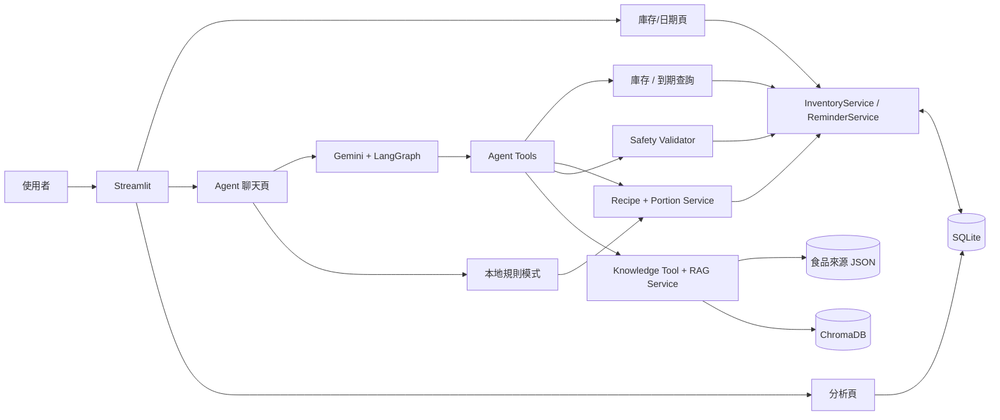

# Food Guardian 系統設計文件

> 智慧食材管理與家庭食物浪費減量 AI Agent  
> 文件更新日期：2026-11-12（依使用者提供之最新 D 組測試結果）  
> 專案：https://github.com/Chen-Fanny/Food-Guardian  
> 文件基礎：原始設計稿 + D 組已完成模組及 Evaluation；不代表該舊 commit 已含新功能

本文件依照 **Problem → Requirements → Architecture → Components → Data → AI/Analytics → Domain Knowledge → Algorithm → Implementation → How to Run → Results** 說明系統。各章以目前程式碼為準，另將後續設計明確標成「規劃」。現階段庫存／提醒與 D 組 AI Agent 核心均有實作；RAG Live、E 組整合及使用者驗收仍待完成。

## 1. Problem｜要解決什麼問題

家庭購買食材後，常因忘記庫存、沒有注意日期或不知道如何搭配料理，導致重複購買和食材丟棄。只提供食譜的聊天機器人也不一定知道家中實際有哪些食材，推薦結果可能仍需要額外採買。

Food Guardian 將食材紀錄、日期提醒與後續餐點建議放在同一套系統中。使用者先記錄食材與數量，再查看需要優先處理的項目；目前 AI 已可透過工具查詢實際庫存和示範食譜資料，說明推薦理由。系統也保留使用與丟棄紀錄，作為後續分析浪費情況的依據。

**目標使用者**：想管理冰箱、冷凍庫及儲藏櫃食材的家庭使用者。第一階段以單一家庭、本機操作的課程展示為範圍。

**成功的判準**：庫存數量正確、操作紀錄可追溯、日期分類符合輸入資料；目前已針對固定測資驗證推薦與數量計算，後續仍須擴充測試，以及實際浪費量是否下降。功能可操作並不等於已證明減少浪費。

## 2. Requirements｜需求與範圍

### 2.1 功能需求與驗收條件

| 編號 | 功能 | 驗收條件 | 目前狀態 |
|---|---|---|---|
| FR-01 | 食材新增與查詢 | 內容驗證、分類與狀態篩選 | 已實作；最新整合需驗收 |
| FR-02 | 編輯與刪除 | active 保護、輸入錯誤的刪除與實際丟棄區隔 | 已實作 |
| FR-03 | 使用／丟棄紀錄 | 不超額、交易一致性、事件 log | 已實作 |
| FR-04 | 日期提醒 | Use By/Best Before、日期邊界、NULL 日期 | 已實作 |
| FR-05 | 庫存 UI | 首頁、dialog、狀態顯示與回饋 | 已實作；跨組人工驗收待做 |
| FR-06 | 庫存導向推薦 | Tool Calling 查庫存、指定人數、缺料與排序 | **已實作且有實際 Tool Trace** |
| FR-07 | 食品保存知識 | JSON/RAG 查詢、資料來源限制與引用 | 已實作；RAG Live 引用品質待驗證 |
| FR-08 | 使用／浪費分析 | 依 logs 計算可比較單位的統計 | Analytics Service 有實作介面；E 組最終驗收待確認 |
| FR-09 | 安全前置篩選 | 依實際庫存日期標示保守分組 | **已實作且有 SQLite Tool Trace** |
| FR-10 | 評估及服務可靠性 | 離線＋Live 工具選擇、API 錯誤分類、有限重試 | **已有測試結果**；人工品質審核待完成 |

### 2.2 非功能需求

- **資料一致性**：庫存扣除與 log 以 SQLite 交易維護；推薦工具以唯讀為原則。
- **可維護性**：UI / Service / Tools / Agent 各司其職，本地規則模式可作沒有 API 時的替代路徑。
- **可解釋性**：LLM 應忠實呈現計算工具回傳的缺額、狀態與理由，不得自行把 `unknown` 寫成 `enough`。
- **領域安全**：`eligible` 僅表示未觸發既定排除規則；不能保證食材安全，未知單位需人工確認。
- **可重現性**：Evaluation 固定測資、保存測試 CSV/summary、區分 API 錯誤與模型工具選擇錯誤。
- **隱私與安全**：`.env`、真實 SQLite 與私有索引不公開；尚無多家庭身份驗證。

### 2.3 暫不實作與限制

未包含 YOLO 食材辨識、IoT 感測器、自行訓練 LLM、多家庭登入、實際保存溫度監測或長期食品浪費減量因果驗證。與初始計畫不同，目前**已導入小型向量檢索 RAG**，但不能將 RAG 靜態文件檢查視為語意檢索品質驗證。

## 3. Architecture｜系統如何組成

系統以 Streamlit 提供操作介面；InventoryService / ReminderService 管理 SQLite；D 組 Gemini + LangGraph Agent 以 Tool Calling 串接既有服務，並保留本地規則模式。Service 計算食材缺額、日期分類和食品安全初篩；LLM 負責理解意圖、選工具及解釋結果。



**主要路徑**：`使用者 → Gemini → LangGraph tool node → Python Tool/Service → SQLite/JSON/ChromaDB → Gemini 生成可追溯回答`。Tool Trace 可提供工具呼叫與參數紀錄；它只能證明工具被呼叫，尚不能單獨保證內容品質。

## 4. Components｜各模組負責什麼

| 元件 | 職責 | 驗證狀態 |
|---|---|---|
| `src/ui/app.py`、`src/ui/components/` | Streamlit 導覽、庫存、提醒、AI 對話、分析介面 | 已有運作紀錄；整合人工驗收待做 |
| `src/database/db_manager.py`、`schema.sql` | SQLite 連線、schema、交易 | 原始模組已實作 |
| `src/services/inventory_service.py`、`reminder_service.py` | 庫存 CRUD、使用／丟棄與日期提醒 | 原始模組已實作 |
| `src/agent/gemini_graph.py`、`gemini_mode.py` | Gemini + LangGraph 流程與工具選擇 | **Live Tool Trace 已驗證** |
| `src/agent/agent_core.py` | 本地／既有 Agent 抽象與相容介面 | 本地模式已有測試 |
| `src/agent/tools/inventory_tools.py` | 庫存、到期食材查詢 | 已實作 |
| `src/agent/tools/recipe_tools.py`、`recipe_service.py` | 食譜查詢、匹配與推薦 | 已實作；食譜量為示範資料 |
| `src/services/portion_service.py` | 指定人數、單位正規化、缺額與雙模式排序 | **計算與 Tool Trace 已驗證** |
| `src/services/safety_service.py` | 依 SQLite 日期資訊執行安全前置篩選 | **工具回傳紀錄已驗證** |
| `knowledge_service.py`、`knowledge_tools.py` | 基礎食品保存知識查詢 | 已實作，範例資料不等於可靠官方依據 |
| `rag_service.py`、`scripts/build_rag_index.py` | ChromaDB RAG 文件索引與檢索 | 已建置；RAG Live 兩題尚待驗證 |
| `analytics_service.py` | 使用／丟棄事件統計 | 需 E 組最終驗收 |
| `evaluation/`、`tests/` | 固定測資、離線測試、Gemini Live 評估、重試與 CSV | **初步 Evaluation 已通過指定範圍** |

本文件中的「已實作」指程式功能或已有測試證據，**不代表已完成全部使用者驗收**。

## 5. Data｜資料來源、結構與生命週期

### 5.1 資料來源

| 資料 | 來源 | 用途與限制 |
|---|---|---|
| 食材庫存 | 使用者手動輸入 | 不是感測器自動盤點；正確性依賴輸入與持續更新 |
| 使用／丟棄紀錄 | Service 在操作時自動建立 | 可追蹤數量、日期與原因；未操作就沒有紀錄 |
| 食品知識 | `food_knowledge.sample.json`、整理的來源文件與 RAG 索引 | 示範 JSON 與來源整理並存；需逐筆核對引用及適用情境 |
| 食譜資料 | `data/knowledge_base/recipes.sample.json` | 已建立小型示範食譜與份量數據；並非標準食譜或大規模資料集 |

本版本尚無正式的 Kaggle 食譜資料集，也未自行訓練模型；推薦採既有示範食譜與決定性 Python 計算，LLM 負責工具協調與語言生成。

### 5.2 SQLite 資料表

**`inventory_items`：每筆食材庫存**

| 欄位 | 型別／規則 | 用途 |
|---|---|---|
| `id` | INTEGER，自動主鍵 | 食材識別 |
| `name`、`category` | TEXT，必填 | 名稱及固定分類 |
| `quantity`、`unit` | REAL、TEXT | 剩餘量及單位；資料庫允許 0，新增／編輯須大於 0 |
| `purchase_date` | TEXT，必填 | 購買日期，Service 使用 `YYYY-MM-DD` |
| `expiry_date` | TEXT，可空 | 使用者輸入的標示日期 |
| `date_label_type` | `use_by`／`best_before`／NULL | 有標示日期時，Service 要求選擇類型 |
| `opened_date` | TEXT，可空 | 實際開封日期，不自動換算新期限 |
| `storage_location` | `refrigerator`／`freezer`／`pantry` | 保存位置 |
| `status` | `active`／`consumed`／`wasted` | 剩餘庫存或完成狀態 |
| `created_at`、`updated_at` | TIMESTAMP | 建立及更新時間 |

**`consumption_waste_logs`：每次使用或丟棄的事件**

包含 `id`、`item_id`、`item_name`、`category`、`quantity`、`unit`、`action_type`、`reason`、`log_date`、`created_at`。名稱、分類、數量與單位為當時快照；刪除庫存後 `item_id` 依外鍵規則設為 NULL，快照仍保留。

**`recipe_recommendations`：預留推薦紀錄表**

包含 `id`、`recipe_title`、`matched_ingredients`、`instructions`、`created_at`。目前主要保留建表定義，尚未驗證 D 組推薦結果寫入此表；D 組推薦資料改由示範 JSON 與 Python 服務提供，不能將這張表視為食譜資料集。

### 5.3 資料生命週期與限制

新增資料為 active。部分使用／丟棄後仍為 active；扣到 0 才將狀態改為最後一次操作的 consumed 或 wasted。因此，狀態不能代表整筆食材全部都被吃掉或全部丟棄，分析必須讀取 logs。

quantity 為 0 的完成紀錄僅供查看，不能再一般編輯、刪除或扣除。補貨請新增一筆；Undo 與歷史更正尚未提供。active 資料仍可編輯，故目前庫存表不是完整的異動稽核帳本。

Schema 初始化使用 `CREATE TABLE IF NOT EXISTS`，不會自動完成舊 schema migration。日期以日曆日計算，依執行主機日期判定「今天」；部署時需確認主機時區符合使用情境。

## 6. AI/Analytics｜AI 與資料分析的角色

### 6.1 Domain AI Agent（D 組已實作）

- **LLM 與協調**：Gemini + LangGraph，對話根據意圖呼叫工具，成功時以 Tool Trace 保留工具名稱和參數。
- **可用工具**：庫存查詢、到期食材查詢、指定份數推薦（`recommend_recipes_for_servings_tool`）、食品保存查詢及 SQLite 安全檢查（`validate_inventory_safety_tool`）；食品知識 RAG 在設定完成時可使用。
- **本地替代方案**：無 `GOOGLE_API_KEY` 或 API 暫不可用時，使用者可自行選擇本地規則模式；**不應假稱 Gemini 請求失敗後已自動退回本地**。
- **數據分工**：Python 服務計算數量、排序、缺額及前置安全規則，Gemini 負責選擇工具、理解自然語言與解釋。
- **關鍵限制**：同一道食譜按份量個別計算；同時製作多道料理時尚無跨食譜共享庫存扣除。菠菜等 `other` 單位不能可靠轉成 `piece`，應回覆人工確認。

**實測範例**：使用者詢問兩人份番茄炒蛋，示範食譜需番茄 2 個及雞蛋 4 個，庫存有番茄 2 個及雞蛋 3 個；工具回傳雞蛋缺少 1 個。`ready_now` 把數量完整的高麗菜炒蛋排前；`expiry_first` 優先考慮較急迫的番茄炒蛋並提示缺料。

### 6.2 Analytics（需 E 組整合驗收）

使用 `consumption_waste_logs` 的實際使用／丟棄事件，依期間、分類、原因和相容單位彙整，並用 Pandas／Plotly 展示。數量不可跨 kg、顆、瓶直接加總。

在單位可比較及分母大於零時可計算：

`浪費比例 = 丟棄量 /（使用量 + 丟棄量）× 100%`

此值只描述**已記錄**的處理量。未收集成本、持續觀察或對照組時，不得宣稱具體節省金額或已證明食物浪費下降。

## 7. Domain Knowledge｜領域知識如何加入

目前採 JSON 食品知識及小型 ChromaDB RAG，支援食品保存知識查詢與來源描述。知識來源可能為 `project_sample`，工具可回傳 `verified=false`；示範 JSON 不能偽裝成官方背書。另有整理的官方資訊摘要，但**引用及適用條件仍須個別核實**。

處理方式：

1. 將食物名稱、日期標示、保存位置、來源和適用條件結構化。
2. RAG 索引以 Sentence Transformers 向量化，ChromaDB 檢索後提供給 Agent 參考。
3. 將來源是否核實、查無資訊及資料不足情況明確提供給使用者。
4. 使用 `validate_inventory_safety_tool` 檢查 SQLite 食材紀錄，依日期標示初步分類，不把 RAG 的文字建議取代安全前置規則。

Use By、Best Before 需依實際產品及所在地標示規定理解；外觀、氣味或日期不能單獨證明可食用。`eligible` 只代表**未觸發目前已知的排除規則**，不是食品安全認證。

**待完成**：RAG Live MUL-02、MUL-04 的實際檢索與引用支持度測試，以及來源人工審核。

## 8. Algorithm｜核心演算法與規則

### 8.1 庫存與日期規則（已實作）

庫存使用／丟棄以 SQLite transaction 更新庫存並新增 log，拒絕超額扣除。日期提醒以 `d = expiry_date − today` 及門檻 `t` 判斷：無日期為 `no_date`、`d < 0` 為 `passed_date`、`0 ≤ d ≤ t` 為 `expiring_soon`、其餘為 `normal`。Reminder 不等於安全檢驗。

### 8.2 Quantity Validator（已實作）

對任一食譜：`所需量 = 原始食譜量 × 目標人數 / 食譜原始人數`；對可比較單位正規化後，`缺少量 = max(0, 所需量 − 可用庫存量)`。支援已定義的公克／公斤、毫升／公升等換算；無法換算的單位保留 `unknown`，不應推定為數量足夠。

### 8.3 雙模式推薦（已實作）

- `ready_now`：優先排序庫存數量足夠、單位可確認的食譜；需要額外食材者應提示缺額。
- `expiry_first`：優先排序可消耗較接近日期的食譜；即使缺料也可能列前，但不得標為可立即製作。
- 既有 `balanced` 模式仍維持相容。實際排序另使用 `quantity_coverage`、`urgency_score` 等內部欄位；**分數代表推薦計算，不代表食品安全程度**。

### 8.4 Safety Validator（已實作；屬前置篩選）

以實際 SQLite active 庫存、日期標示及已知風險作保守規則分類：`eligible`（無已知阻擋條件）、`review`（需人工檢查）、`blocked`（排除自動推薦）。不可將 `eligible` 寫為「確定安全」。目前無實際溫度、開封後保存條件的充分驗證。

### 8.5 Agent Reliability 與 Evaluation（已有初步驗證）

Live 評估以工具 Trace 檢查必要工具是否被呼叫，對 API 暫時不可用錯誤使用**有限次數重試**。API Success Rate 與 Valid Tool Selection Accuracy 分開計算：若請求因 503 中止，應標記 `API_ERROR`，不能直接視為模型選錯工具。回覆的事實正確性、RAG groundedness 和安全符合度仍需人工評分。

## 9. Implementation｜實作方式與後續整合

### 9.1 依賴與程式結構

原組員的 Streamlit、Pandas、NumPy、Plotly、Pydantic、python-dotenv 等依賴保留；D 組加入 LangGraph、LangChain Google GenAI、Gemini SDK、ChromaDB 與 Sentence Transformers。正式套件列於 `requirements.txt`，測試工具另見 `requirements-dev.txt`。開發紀錄中的 Windows Conda 環境為 Python 3.11；實際部署應用 `pip check` 驗證依賴。

主要實作：`src/agent/gemini_graph.py`、`gemini_mode.py`、`src/services/portion_service.py`、`safety_service.py`、`rag_service.py`、`evaluation/run_evaluation.py`、`retry_handler.py`、`metrics.py`。**功能測試檔命名不含歷史版本號**，避免重複維護。

### 9.2 開發現況與剩餘工作

1. D 組 Agent、數量驗證與雙模式推薦已有工具呼叫實測。
2. 需完成 RAG Live 搜尋與引用品質、人工 Task Completion 與 Safety 回覆審核。
3. 與 C 組庫存表單統一 `other`／把／包／個等單位語意；不能任意以數量換算重量。
4. 與 E 組確認 Analytics Service 和 Dashboard 的資料正確性。
5. 完整 Demo、UI 整合、長期浪費減量成效與足夠樣本的重測仍待完成。

### 9.3 系統部署與金鑰保護

`.env` 置於專案根目錄並加入 `.gitignore`，不可公開；真實 SQLite 及 ChromaDB 索引不應直接隨分享壓縮包散布。單一 SQLite 並非多家庭權限隔離設計。時間相關測試以固定測資日期執行，正式服務依當前日期與時區計算，不可把舊測試庫存當作實際安全狀態。

## 10. How to Run｜安裝與執行

### 10.1 Windows Conda 環境

```powershell
conda activate foodguardian
python -m pip install -r requirements-dev.txt
python -m pip check
```

將 `.env.example` 複製為專案根目錄的 `.env`，設定自己的 `GOOGLE_API_KEY`、實際可用的 `GEMINI_MODEL` 與 `AGENT_MODE=gemini`。如要使用 RAG，請確保索引可用並設定 `RAG_ENABLED=true`，必要時執行：

```powershell
python scripts/build_rag_index.py
```

### 10.2 啟動及測試

```powershell
python -m streamlit run src/ui/app.py
python -m pytest tests -q
python evaluation/run_evaluation.py
```

Gemini Live 多工具評估（會產生外部 API 呼叫與可能的費用）：

```powershell
python evaluation/run_evaluation.py --live --category multi_tool --limit 3 --max-retries 1
```

結果輸出至 `evaluation/results/`。離線固定庫存不應操作正式 SQLite。`--limit 3` 只限制符合條件的案例數；需要真正 RAG 搜尋的兩題預設列入 `skipped_cases`，不是執行失敗。

### 10.3 簡要人工驗收

1. 確認庫存 CRUD 和日期提醒操作無誤。
2. 在聊天頁要求「兩人份番茄炒蛋」，查看份量、缺額與 `recommend_recipes_for_servings_tool` Trace。
3. 分別測試 `ready_now` / `expiry_first`，觀察排序差異。
4. 使用 `validate_inventory_safety_tool` 查 SQLite 某一筆食材，確認回傳的日期標示、原因及聲明。
5. 重新建立 RAG 索引並抽查實際來源引用。
6. 檢查 Evaluation CSV 與 summary 中的 API／工具評估分母一致，保留原始結果。

## 11. Results｜目前成果、證據與評估計畫

### 11.1 已取得的 D 組成果

以下是**使用者在原開發環境實際執行的 Evaluation v3.3 摘要**；不同於原始設計稿中的「AI 未完成」狀態：

| 指標 | 實際記錄 | 解釋 |
|---|---:|---|
| 評估情境總數 | 30 | 六類，每類 5 題 |
| 離線 PASS | 25 | 決定性邏輯及來源文件靜態檢查 |
| 離線 NOT_RUN | 5 | 需 Gemini 的多工具情境 |
| Gemini Live attempted | 3 | 排除 RAG 相依案例 MUL-02、MUL-04 |
| API Success Rate | 3/3 = 100% | 僅代表當輪 3 個請求 |
| Valid Tool Selection Accuracy | 3/3 = 100% | 僅針對有效回應的工具 Trace |
| 額外重試次數 | 1 | 有使用有限次數退避重試的記錄 |
| 成功請求平均耗時 | 11.71 秒 | 僅該輪的成功請求 |

先前不同輪次曾出現 503 `UNAVAILABLE`，更新後可將 `API_ERROR` 與 `TOOL_MISMATCH` 分開報告。上表**不能解讀為全部 30 題通過、RAG 檢索準確率 100% 或已經證明食品安全**。

### 11.2 當前已驗證的工具情境

- `recommend_recipes_for_servings_tool(servings=2, mode=ready_now)`：高麗菜炒蛋在數量條件上優先。
- `recommend_recipes_for_servings_tool(servings=2, mode=expiry_first)`：番茄炒蛋到期優先但顯示雞蛋缺 1 個。
- `validate_inventory_safety_tool(item_name=雞胸肉)`：成功讀取 SQLite 實際庫存與日期規則狀態；eligible 不是食品安全保證。

### 11.3 待完成、不能宣稱已通過的項目

- RAG Live MUL-02／MUL-04：需實際檢索與證據支持度評分。
- Task Completion、RAG Groundedness、Food Safety 回覆品質的人工審核。
- C／D／E 合併後完整端對端測試、資料一致性與實際使用者驗收。
- 較大樣本、不同時間的 API 穩定性測試與長期食物浪費減量實驗。

相關文件：[`docs/EVALUATION_REPORT.md`](docs/EVALUATION_REPORT.md)、[`docs/PRESENTATION_OUTLINE.md`](docs/PRESENTATION_OUTLINE.md)。保留測試原始 CSV，不合併不同輪次作無根據的平均。

