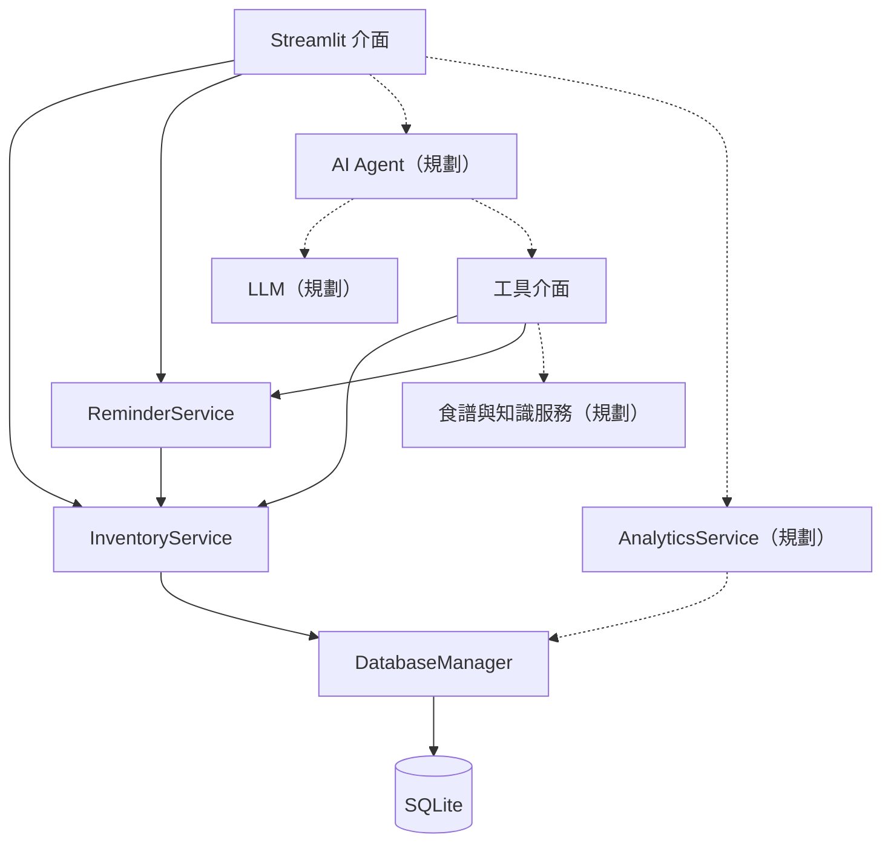

# Food Guardian 系統設計文件

> 智慧食材管理與家庭食物浪費減量 AI Agent  
> 文件檢視日期：2026-10-24  
> 專案：https://github.com/Chen-Fanny/Food-Guardian  
> 對照版本：`bcb290303db82149ea04765ea6a546f98956ebac`

本文件依照 **Problem → Requirements → Architecture → Components → Data → AI/Analytics → Domain Knowledge → Algorithm → Implementation → How to Run → Results** 說明系統。各章以目前程式碼為準，另將後續設計明確標成「規劃」。目前可使用的核心是庫存與日期提醒；完整 AI Agent 尚未完成。

## 1. Problem｜要解決什麼問題

家庭購買食材後，常因忘記庫存、沒有注意日期或不知道如何搭配料理，導致重複購買和食材丟棄。只提供食譜的聊天機器人也不一定知道家中實際有哪些食材，推薦結果可能仍需要額外採買。

Food Guardian 將食材紀錄、日期提醒與後續餐點建議放在同一套系統中。使用者先記錄食材與數量，再查看需要優先處理的項目；日後 AI 可查詢實際庫存和食譜資料，說明推薦理由。系統也保留使用與丟棄紀錄，作為後續分析浪費情況的依據。

**目標使用者**：想管理冰箱、冷凍庫及儲藏櫃食材的家庭使用者。第一階段以單一家庭、本機操作的課程展示為範圍。

**成功的判準**：庫存數量正確、操作紀錄可追溯、日期分類符合輸入資料；後續再驗證推薦是否符合庫存，以及實際浪費量是否下降。功能可操作並不等於已證明減少浪費。

## 2. Requirements｜需求與範圍

### 2.1 功能需求與驗收條件

| 編號 | 功能 | 驗收條件 | 目前狀態 |
|---|---|---|---|
| FR-01 | 食材新增與查詢 | 名稱不可空白，數量為正數；可依分類、位置和狀態篩選 | 已實作 |
| FR-02 | 編輯與刪除 | 僅操作 active 紀錄；刪除用於輸入錯誤，與實際丟棄分開 | 已實作 |
| FR-03 | 使用／丟棄紀錄 | 支援部分扣除，不得超過庫存；庫存與 log 同時成功或回復 | 已實作 |
| FR-04 | 日期提醒 | 分辨正常、即將到期、超過日期及未設定日期；包含當天邊界 | 已實作 |
| FR-05 | 首頁與庫存介面 | 顯示 active 食材筆數、提醒與操作回饋 | 已實作，仍需使用者驗收 |
| FR-06 | 庫存導向餐點推薦 | 從真實庫存與食譜資料產生建議，列出缺少食材及推薦理由 | 規劃 |
| FR-07 | 食品保存知識查詢 | 回覆附有來源與適用條件；查無資料時明確告知 | 規劃 |
| FR-08 | 使用與浪費分析 | 從 logs 計算期間及分類統計，不混加不同單位 | 規劃 |

### 2.2 非功能需求

- **資料一致性**：使用／丟棄採資料庫交易；同時操作時不可重複超額扣除。
- **可維護性**：UI、Service、資料庫與 Agent adapter 分層；固定選項集中管理。
- **可理解性**：介面使用中文標籤，資料庫使用固定英文值；錯誤訊息讓使用者知道如何修正。
- **可重現性**：設定檔、資料表與啟動方式納入版本控制；實驗結果應記錄資料版本、模型與條件。
- **資料與金鑰管理**：本機資料庫保留使用紀錄，`.env` 不提交；未實作登入、家庭隔離與正式雲端備份。
- **領域限制**：日期提醒不代表食品安全判定；缺少保存條件時，不推定食物可食用。

### 2.3 第一階段不包含

影像辨識、IoT 感測器、大型向量資料庫、自行訓練大型模型、多家庭帳號及付款功能均不在目前範圍內。背景推播與排程通知也尚未實作，提醒目前顯示在網頁中。

## 3. Architecture｜系統如何組成

採用 Python 單體應用與分層設計。Streamlit 負責互動，Service 負責資料驗證與業務規則，DatabaseManager 管理 SQLite 連線及交易。庫存、提醒不需要呼叫 LLM。



實線表示目前已有實作的主要依賴；虛線表示待串接的設計。工具介面中只有庫存查詢 adapter 已有實作，尚未接入真正的 LLM tool-calling 流程。

**設計理由**：SQLite 適合本機原型，不需要另外架設資料庫；Service 可同時提供 UI 與未來 Agent 使用，避免兩套庫存邏輯。當使用人數或並行寫入增加時，再評估獨立 API 與其他資料庫。

## 4. Components｜各模組負責什麼

| 元件／檔案 | 責任 | 狀態 |
|---|---|---|
| `src/ui/app.py` | 頁面導覽、初始化資料庫、錯誤處理與頁面組裝 | 已實作 |
| `src/ui/components/home_view.py` | active 庫存概況與優先處理清單 | 已實作 |
| `inventory_view.py`、`item_dialogs.py` | 篩選、詳細資料及新增／編輯／使用／丟棄／刪除視窗 | 已實作 |
| `reminders_view.py` | 日期分類與提醒天數選擇 | 已實作 |
| `src/services/inventory_service.py` | CRUD、欄位驗證、數量扣除與 log 寫入 | 已實作 |
| `src/services/reminder_service.py` | 計算剩餘天數、分類 active 庫存 | 已實作 |
| `src/database/db_manager.py` | 建立路徑、讀取 schema、連線與交易生命週期 | 已實作 |
| `src/database/schema.sql` | 資料表定義的唯一來源 | 已實作 |
| `src/agent/tools/inventory_tools.py` | `query_active_inventory`、`query_expiring_items` 查詢 adapter | 已實作 |
| `src/agent/agent_core.py` | 工具註冊、自然語言推理與 tool-calling 協調 | 僅工具定義註冊已有實作，推理未完成 |
| `recipe_service.py`、`recipe_tools.py` | 食譜匹配與工具封裝 | 骨架 |
| `knowledge_service.py`、`knowledge_tools.py` | JSON 知識載入、查詢與工具封裝 | 骨架 |
| `analytics_service.py` | 使用與丟棄統計 | 骨架 |
| `agent_chat_view.py`、`analytics_view.py` | AI 對話與分析頁面 | 僅開發中提示 |
| `src/constants.py`、`src/config.py`、`src/utils/helpers.py` | 固定選項、環境設定、日期解析 | 已實作 |

檔名未列完整路徑者位於同列對應的模組目錄。UI 不直接執行 SQL；Agent 工具不自行重寫扣庫存規則。

## 5. Data｜資料來源、結構與生命週期

### 5.1 資料來源

| 資料 | 來源 | 用途與限制 |
|---|---|---|
| 食材庫存 | 使用者手動輸入 | 不是感測器自動盤點；正確性依賴輸入與持續更新 |
| 使用／丟棄紀錄 | Service 在操作時自動建立 | 可追蹤數量、日期與原因；未操作就沒有紀錄 |
| 食品知識 | `food_knowledge.sample.json` | 現有 4 筆食材範例，只供結構示意，尚無逐筆來源欄位 |
| 食譜資料 | 尚未導入 | 待選定資料集或 API，確認授權與食材欄位後才能比較推薦結果 |

本版本沒有已確定的 Kaggle 食譜資料集，也沒有已完成的訓練資料與模型實驗。不得將未導入的外部資料寫成既有資料來源。

### 5.2 SQLite 資料表

**`inventory_items`：每筆食材庫存**

| 欄位 | 型別／規則 | 用途 |
|---|---|---|
| `id` | INTEGER，自動主鍵 | 食材識別 |
| `name`、`category` | TEXT，必填 | 名稱及固定分類 |
| `quantity`、`unit` | REAL、TEXT | 剩餘量及單位；資料庫允許 0，新增／編輯須大於 0 |
| `purchase_date` | TEXT，必填 | 購買日期，Service 使用 `YYYY-MM-DD` |
| `expiry_date` | TEXT，可空 | 使用者輸入的標示日期 |
| `date_label_type` | `use_by`／`best_before`／NULL | 有標示日期時，Service 要求選擇類型 |
| `opened_date` | TEXT，可空 | 實際開封日期，不自動換算新期限 |
| `storage_location` | `refrigerator`／`freezer`／`pantry` | 保存位置 |
| `status` | `active`／`consumed`／`wasted` | 剩餘庫存或完成狀態 |
| `created_at`、`updated_at` | TIMESTAMP | 建立及更新時間 |

**`consumption_waste_logs`：每次使用或丟棄的事件**

包含 `id`、`item_id`、`item_name`、`category`、`quantity`、`unit`、`action_type`、`reason`、`log_date`、`created_at`。名稱、分類、數量與單位為當時快照；刪除庫存後 `item_id` 依外鍵規則設為 NULL，快照仍保留。

**`recipe_recommendations`：預留推薦紀錄表**

包含 `id`、`recipe_title`、`matched_ingredients`、`instructions`、`created_at`。目前只有建表定義，尚未實作寫入與查詢推薦流程；不能視為已存在的食譜資料集。

### 5.3 資料生命週期與限制

新增資料為 active。部分使用／丟棄後仍為 active；扣到 0 才將狀態改為最後一次操作的 consumed 或 wasted。因此，狀態不能代表整筆食材全部都被吃掉或全部丟棄，分析必須讀取 logs。

quantity 為 0 的完成紀錄僅供查看，不能再一般編輯、刪除或扣除。補貨請新增一筆；Undo 與歷史更正尚未提供。active 資料仍可編輯，故目前庫存表不是完整的異動稽核帳本。

Schema 初始化使用 `CREATE TABLE IF NOT EXISTS`，不會自動完成舊 schema migration。日期以日曆日計算，依執行主機日期判定「今天」；部署時需確認主機時區符合使用情境。

## 6. AI/Analytics｜AI 與資料分析的角色

### 6.1 AI Agent（規劃）

預定流程為：理解使用者需求 → 選擇唯讀工具 → 查詢實際資料 → 由 Python 執行匹配／計算 → LLM 整理結果與依據。

例如「今晚能做什麼，先用快到期的食材」，Agent 應先查庫存與日期，再取得候選食譜，列出使用食材、缺少食材與優先原因。不能憑語言模型記憶聲稱家中有某項食材，也不能在資訊不足時承諾食品安全。

後續需實作工具 schema、呼叫分派、參數驗證、多輪工具結果回傳、最大輪數、逾時與 API 失敗處理，以及來源與查詢時間呈現。目前 `FoodGuardianAgent.process_query()` 直接拋出 `NotImplementedError`。

LLM 設定已預留 `OPENAI_API_KEY`、`LLM_MODEL` 與 `LLM_TEMPERATURE`，預設模型名稱為 `gpt-4o-mini`，溫度為 `0.2`；這只是程式預設值，不代表已呼叫或驗證模型。推薦本身不應自動扣庫存，實際使用量仍由使用者確認紀錄。

### 6.2 Analytics（規劃）

以 `consumption_waste_logs` 為事件來源，使用 Pandas 依期間、分類、原因及單位彙整，再用 Plotly 呈現。首頁現有的筆數 KPI 與完整浪費分析是不同功能。

同一可比較單位下，可定義：

`浪費比例 = 丟棄量 /（使用量 + 丟棄量）× 100%`

此指標僅描述已記錄的處理量；分母為 0 時應顯示「無資料」。不得把 kg、顆、瓶直接加總。未來若要統一重量，需補單位轉換與單件重量；若要估算金額，需補價格資料。目前 schema 沒有成本欄位，不能產生可信的節省金額。

## 7. Domain Knowledge｜領域知識如何加入

系統需要食材分類、保存位置、日期標示、保存條件與料理搭配知識。現在的日期規則已落在 `constants.py` 與 ReminderService；保存知識查詢尚未完成。

目前範例 JSON 有 categories 與 items，包含名稱、保存方式、示意保存天數、變質徵兆及減量提示。但它不是經來源審核的正式知識庫；其中分類、單位和保存方式也未完全對齊庫存固定值，例如 `dairy` 與 `egg_dairy`、`pieces` 與 `piece`、`refrigerated` 與 `refrigerator`。

正式整合前應完成以下工作：

1. 為每筆知識補上來源名稱、URL、查核日期、適用地區與保存條件。
2. 統一分類、單位、保存位置與食材別名，保留原始資料及對照表。
3. 將示意保存天數與產品實際標示分開，不用範例天數覆蓋使用者輸入的日期。
4. 審核所有保存與可食用相關敘述；不把單一外觀、氣味或浮水測試當作安全保證。
5. 對查無資料、來源過時或條件不足的問題，回傳限制及需要補充的資訊。

日期分類只回答「距離輸入日期還有幾天」。Use By 與 Best Before 的提示需保留差異，實際解讀仍應配合產品標示與適用規範；本版沒有實作跨地區法規推理。

## 8. Algorithm｜核心演算法與規則

### 8.1 庫存扣除（已實作）

```text
輸入：item_id、操作數量 q、action（consumed 或 wasted）
1. 確認 q 為大於 0 的有限數值。
2. 開始 BEGIN IMMEDIATE 交易，取得寫入鎖後讀取食材。
3. 確認食材存在、status = active、現有量 Q > 0，且 q ≤ Q。
4. 以 Decimal 計算 R = Q − q，檢查轉回 REAL 的可表示精度。
5. 更新 quantity = R；R > 0 時維持 active，否則設為 action。
6. 新增本次 log，保存食材名稱、分類、數量、單位與日期。
7. 一起 commit；任一步失敗則 rollback，最後關閉連線。
```

SQLite 儲存型別仍是 REAL；使用 Decimal 是降低扣除計算誤差，不代表資料庫具有任意精度。

### 8.2 日期提醒（已實作）

令 `d = expiry_date − today`，單位為日，提醒門檻為 `t`：

| 條件 | 結果 |
|---|---|
| 沒有日期 | `no_date` |
| `d < 0` | `passed_date` |
| `0 ≤ d ≤ t` | `expiring_soon` |
| `d > t` | `normal` |

只計算 active 食材。預設門檻 3 天，UI 提供 1、3、5、7 天；Service 接受非負整數。`query_expiring_items()` 不包含超過日期與無日期項目。`get_expired_items()` 的名稱只表示超過輸入日期，不是安全判定。

### 8.3 食譜排序（建議設計，尚未實作）

先做食材名稱與別名正規化，再取得候選食譜。對每道食譜計算：

- 庫存覆蓋率：已具備的必要食材種類數／必要食材種類總數。
- 即期利用量：可使用的即將到期食材種類數。
- 缺料數：目前沒有的必要食材種類數。

第一版可依「即期利用種類數降冪 → 覆蓋率降冪 → 缺料數升冪」排序，使用固定食譜 ID 打破平手。種類匹配不等於份量足夠；取得食譜份量與單位後，才加入數量驗證。超過標示日期的食材不自動納入可用推薦集合。過敏原與飲食限制若要支援，需先取得完整資料並作前置篩選。

此規則可作可解釋的 baseline，日後再與單純庫存匹配或一般 LLM 建議比較。未實作前不宣稱推薦準確率。

## 9. Implementation｜實作方式與後續整合

### 9.1 現有技術

Python 3.10+、Streamlit、SQLite 與 python-dotenv 為現有主要依賴。requirements 另列 Pandas、NumPy、Plotly、OpenAI SDK、Pydantic、pytest、flake8，供後續分析、AI 與驗證使用；列入依賴不等於功能已完成。Streamlit 需求為 `>=1.66.0`，目前依賴未鎖定精確版本。

資料庫操作使用參數化 SQL；每次連線啟用 foreign keys，以 `sqlite3.Row` 取得欄位資料。Service 統一驗證名稱、數量、日期與固定選項。找不到 ID 拋出 LookupError，無效輸入或修改完成紀錄拋出 ValueError，由 UI 轉成可理解的提示。

### 9.2 開發順序

1. 補齊並提交庫存／提醒測試與人工驗收紀錄，修正 README 中失效的文件連結。
2. 審核知識資料來源與欄位對照，完成 KnowledgeService 及工具查詢。
3. 選定有授權的食譜資料，完成清理與可解釋匹配 baseline。
4. 實作 Agent 推理迴圈與工具呼叫，再串接對話頁面。
5. 實作 logs 分析、統計頁面與實驗匯出，完成比較與使用者驗證。

### 9.3 部署注意事項

目前沒有登入與家庭資料隔離；直接部署成公開服務會讓共用資料庫的使用者存取同一份庫存。正式部署前需完成存取控制，並確認持久化磁碟、備份與時區設定。SQLite 檔案應以備份方式保護，不能假設暫存執行環境會永久保留。

## 10. How to Run｜安裝與執行

### 10.1 下載與安裝

macOS／Linux，在終端機執行：

```bash
git clone https://github.com/Chen-Fanny/Food-Guardian.git
cd Food-Guardian
python3 -m venv .venv
source .venv/bin/activate
python -m pip install --upgrade pip
python -m pip install -r requirements.txt
cp .env.example .env
```

Windows PowerShell 建立及啟用虛擬環境：

```powershell
python -m venv .venv
.\.venv\Scripts\Activate.ps1
python -m pip install -r requirements.txt
Copy-Item .env.example .env
```

### 10.2 設定與啟動

庫存及提醒不需要 API Key。預設資料庫為 `data/database/food_guardian.db`；可在 `.env` 設定 `DATABASE_PATH`。首次開啟首頁、庫存或提醒頁時，自動建立資料夾與資料表。請勿將真實金鑰提交到版本控制。

```bash
python -m streamlit run src/ui/app.py
```

開啟終端機顯示的 Local URL，通常為 `http://localhost:8501`。停止程式按 Ctrl+C；重啟後以相同資料庫路徑讀取既有紀錄。AI 推薦與分析頁目前只顯示開發中訊息。

### 10.3 最小人工驗收

1. 新增雞蛋 10 個，分類選蛋／乳製品、單位選個、位置選冷藏，填寫日期與標示類型。
2. 使用 3 個後，確認剩餘 7 個且仍是 active。
3. 嘗試使用 8 個，確認操作被拒絕且庫存不變。
4. 丟棄 2 個後，確認剩餘 5 個，資料庫有兩筆操作 log。
5. 使用最後 5 個，確認數量為 0、狀態為 consumed，且編輯／刪除／再次扣除不可用。
6. 另新增日期為昨天、今天、門檻當天、門檻隔天及未設定日期的資料，確認對應分類。
7. 重啟程式，確認資料保留。測試時請指定獨立的 DATABASE_PATH。

目前對照版本沒有提交 `tests/`，因此 README 的 `pytest tests/` 不能作為本版可直接重現的測試流程。待測試檔補齊後再執行；本文件不將缺失的測試視為已通過。

## 11. Results｜目前成果、證據與評估計畫

### 11.1 目前可以確認的成果

| 項目 | 可確認內容 | 證據與限制 |
|---|---|---|
| 庫存與操作紀錄 | CRUD、部分使用／丟棄、交易與完成紀錄保護已有程式 | `inventory_service.py`、`schema.sql`；本次以原始碼檢視確認 |
| 日期提醒 | active 篩選、日期邊界、NULL 日期分類已有實作 | `reminder_service.py`、`helpers.py` |
| 網頁介面 | 首頁、庫存、提醒與操作 dialog 已有程式 | `src/ui/`；`docs/screenshots/` 有既有截圖 |
| AI、食譜、知識與分析 | 有模組邊界與方法骨架 | 核心方法仍拋出 NotImplementedError，不能展示完整流程 |
| 浪費減量與推薦效能 | 尚無可重現的量化結果 | 未提供實驗資料、baseline 結果或使用者研究 |

README 記載「83 tests passed」與瀏覽器驗證，但本次下載的版本沒有 `tests/`、`TODO.md`、`docs/architecture.md` 或 `docs/ui-redesign-validation.md`。因此這些通過數與驗證細節僅能視為既有文件記載，無法在此版本獨立重現。本次環境也未安裝 Streamlit、python-dotenv 與 pytest，未執行應用或完整測試。

### 11.2 後續驗證與應交付證據

| 驗證面向 | 方法 | 應保留的結果 |
|---|---|---|
| 資料正確性 | CRUD、超額扣除、rollback、並行操作與歷史保護測試 | 測試檔、環境版本與執行報告 |
| 日期邊界 | 固定 today，測試 -1、0、t、t+1 與 NULL | 預期與實際分類對照 |
| 工具呼叫 | 固定問題與庫存，檢查工具選擇、參數及資料依據 | 成功率、失敗案例、延遲與模型版本 |
| 推薦品質 | 同一份庫存與食譜，比較一般匹配與即期優先排序 | 覆蓋率、缺料數、即期利用及人工評分 |
| 知識可信度 | 抽查來源、適用條件與未知問題回覆 | 查核紀錄及不當安全保證案例數 |
| 浪費減量 | 比較相同長度觀察期並控制紀錄方式與可比較單位 | 各期使用／丟棄量、浪費比例、樣本數與限制 |

觀察期、樣本數與門檻應在實驗前訂定。沒有控制條件時，前後差異只能當作觀察結果，不能直接歸因於 AI。最終報告應同時呈現有效案例與失敗案例，保留匿名化資料及計算方式，讓其他人可以重現。
