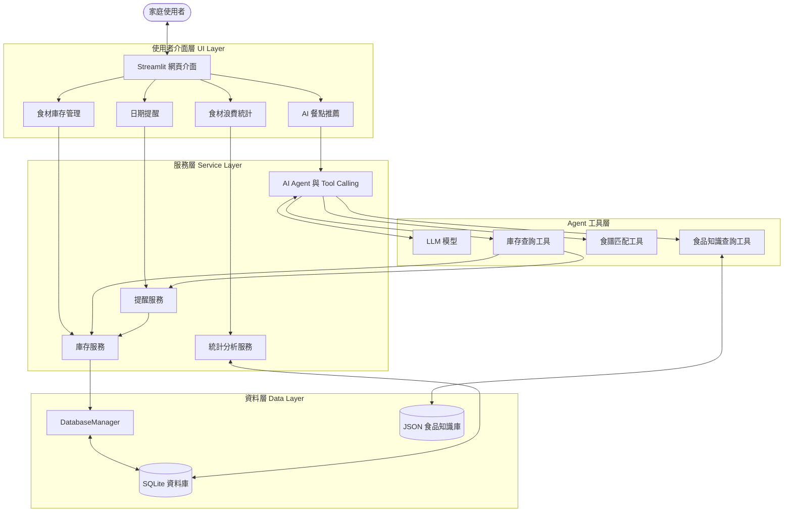

# 🥑 Food Guardian｜智慧食材管理與家庭食物浪費減量 AI Agent

> **Food Guardian: A Knowledge-Guided AI Agent for Smart Food Inventory Management and Household Food Waste Reduction**

[](https://github.com/Chen-Fanny/Food-Guardian)
[](https://www.python.org/)
[](https://streamlit.io/)
[](LICENSE)


## 📌 目錄

- [專題介紹](#-專題介紹)
- [研究動機](#-研究動機)
- [預計實作功能](#-預計實作功能)
- [Inventory & Reminder Module](#inventory--reminder-module)
- [Web Interface](#web-interface)
- [系統架構](#️-系統架構)
- [使用技術](#️-使用技術)
- [專案資料夾結構](#-專案資料夾結構)
- [安裝與環境設定](#-安裝與環境設定)
- [執行方式](#-執行方式)
- [Demo 展示](#-demo-展示)
- [開發進度](#️-開發進度)
- [組員分工](#-組員分工)
- [授權](#-授權)

## 📖 專題介紹

**Food Guardian** 是一套輕量化的智慧家庭食材管理 **AI Agent** 系統，旨在協助使用者記錄食材庫存、查看食品日期標示與提醒、依照現有食材取得餐點建議，以及追蹤食材使用與丟棄情況。

本專題預計結合 **大型語言模型（LLM）與 Tool Calling**、食材資料庫、Python 資料分析，以及小型食品保存知識庫。與直接向聊天機器人詢問食譜不同，Food Guardian 的目標是讓 AI 能透過工具查詢**實際庫存**與**既有食譜資料**，再提供可說明依據的建議。

本系統提供的食品日期資訊與保存提醒僅供輔助管理，**不能取代實際食品安全判斷**；資訊不足時應提醒使用者進一步確認，而非保證食材可安全食用。

## 💡 研究動機

家庭食物浪費不僅造成金錢損失，也代表生產、運輸與保存食品時投入的資源未被充分利用。本專題聚焦三項常見痛點：

1. **日期標示容易混淆**：消費者可能不清楚 *Use By*（依各地標示法規理解）與 *Best Before*（最佳賞味期限）等標示的差別。日期標示與食品安全不能一概而論。
2. **忘記已購買的食材**：食材放在冰箱或儲藏櫃中，可能因缺乏紀錄而被遺忘或重複購買。
3. **缺少符合庫存的餐點建議**：即使知道哪些食材需要優先處理，也不一定知道可以做什麼料理。

Food Guardian 希望透過庫存可視化、日期提醒與 AI 輔助餐點推薦，幫助使用者更有效率地利用現有食材。實際減少食物浪費的效果將留待實驗與使用紀錄驗證。

## 🚀 預計實作功能

專案處於 **In Development**；Inventory & Reminder 功能已實作並通過自動測試，尚待人工操作驗收。AI Agent、Knowledge Base 與 Analytics 仍為 Planned，整體專案尚未完成。

| 編號 | 功能 | 說明 | 狀態 |
|---|---|---|---|
| 1 | **食材庫存管理** | 新增、查看、修改、刪除食材；記錄數量、保存位置與日期資訊，支援部分使用／丟棄與歷史紀錄保護 | `In Development`（待人工驗收） |
| 2 | **食材日期提醒** | 依使用者輸入的日期及標示類型提供提醒，不直接判定食品安全 | `In Development`（待人工驗收） |
| 3 | **AI Agent 食譜推薦** | 透過 LLM Tool Calling 查詢庫存、搜尋食譜並說明推薦原因 | `Planned` |
| 4 | **基本食品知識查詢** | 查詢整理自可靠來源的小型 JSON 食品保存知識庫 | `Planned` |
| 5 | **使用與浪費統計** | 使用 Pandas 統計食材使用及丟棄紀錄，產生圖表 | `Planned` |

**實作範圍：** 優先完成可操作的 Web Demo、資料查詢及推薦結果；本階段不包含 YOLO 食材辨識、IoT 感測器、大型 RAG 向量資料庫或自行訓練大型模型。

## Inventory & Reminder Module

本模組負責 SQLite food inventory、CRUD、Consumed / Wasted 紀錄、Date Reminder，以及 Streamlit Inventory / Reminder UI。目前功能已實作並通過自動測試，人工操作驗收尚未完成，模組狀態保持 **In Development**。

```text
Streamlit → InventoryService / ReminderService → DatabaseManager → SQLite
AI Agent → inventory_tools.py → InventoryService / ReminderService
ReminderService → InventoryService（查詢 active 庫存）
```

UI 不直接操作 SQLite，也不執行 SQL；`inventory_tools.py` 是 Service 的薄層 Adapter。Agent Core、Prompt、Recipe、Knowledge Base 與 Analytics 維持原有 Planned 狀態。

### 庫存操作

- **Create / Read / Update**：新增、查詢及編輯庫存，支援分類、保存位置及狀態篩選。Category、Unit、Storage、Date Label 使用 `src/constants.py` 的固定英文值，UI 顯示中文。
- **Delete**：只用於輸入錯誤的 active 資料，採 Hard Delete；不等於吃掉或丟掉。已有 logs 會保留食材名稱、分類、數量及單位快照，`item_id` 依既有外鍵規格設為 NULL。
- **Consumed**：實際使用食材，減少庫存並新增 consumed log。
- **Wasted**：實際丟棄食材，減少庫存並新增 wasted log，可填寫 reason。

例如雞蛋 10 顆，Consumed 3 顆後剩餘 7 顆，status 仍為 active。只有剩餘 quantity = 0 時，才將 status 設為最後一次操作的 consumed / wasted。新增／編輯的 quantity 及使用／丟棄數量必須大於 0，操作不可超過庫存。

quantity = 0 且 status = consumed / wasted 時，資料為 **Completed Historical Record**：僅供查看，不允許一般 Edit、Hard Delete、Consume 或 Waste；UI 停用相關按鈕，Service 同樣拒絕操作。本版不提供 Undo / Correction，補貨請新增一筆；未來更正功能需以單一 transaction 同步處理 inventory 與 logs。

使用／丟棄以單一 transaction 更新庫存與 log；任一寫入失敗會 rollback。SQLite 的 `BEGIN IMMEDIATE` 可避免同時操作超額扣除。數量採既有 SQLite REAL；Service 使用 Decimal 計算扣除，並拒絕非有限數量。

### 日期提醒

`date_label_type` 僅包含 **Use By** 與 **Best Before**；實際開封日期 `opened_date` 為獨立欄位，不會自動推算新的到期日。`expiry_date` 可為 NULL，UI 顯示「未設定日期」，不納入提醒；填寫 expiry_date 時須選擇日期標示類型。

Reminder 預設 3 天，UI 可選 **1 / 3 / 5 / 7** 天，只計算 active 庫存：

| 條件 | 分類 |
|---|---|
| 剩餘天數 > 門檻 | normal／正常 |
| 0 ≤ 剩餘天數 ≤ 門檻（包含今天） | expiring_soon／即將到期 |
| 剩餘天數 < 0 | passed_date／已超過日期 |
| expiry_date 為 NULL | no_date／未設定日期 |

Use By 與 Best Before 顯示不同的中性提示，Best Before 提示其品質資訊性質。`get_expired_items()` 僅表示超過輸入日期，**不能取代實際食品安全判斷**，也不保證一定安全或一定不能吃。

### 資料庫與 Service

`schema.sql` 為 schema single source of truth。DatabaseManager 自動建立資料夾、重複初始化、每次連線啟用 foreign keys，並使用 sqlite3.Row。Service 透過 context manager commit / rollback 並關閉連線。

| 資料表 | 用途／欄位 |
|---|---|
| `inventory_items` | id、name、category、quantity、unit、purchase_date、expiry_date（nullable）、date_label_type、opened_date、storage_location、status、created_at、updated_at |
| `consumption_waste_logs` | 使用／丟棄紀錄；item_id、item_name、category、quantity、unit、action_type、reason、log_date、created_at |
| `recipe_recommendations` | **Optional / Planned**；保留原有 schema，尚未實作推薦功能 |

預設資料庫為 `data/database/food_guardian.db`；可透過 `DATABASE_PATH` 指定其他路徑。首次進入首頁／庫存／提醒頁面自動初始化，重啟使用同一檔案保留資料。此次 Repository 無舊資料庫，因此未實作舊版 schema 的 migration。

程式整合範例：

```python
from src.database.db_manager import DatabaseManager
from src.services.inventory_service import InventoryService
from src.services.reminder_service import ReminderService

db = DatabaseManager()
db.initialize_database()
inventory = InventoryService(db)
active_items = inventory.get_items(status="active")
all_items = inventory.get_items(status=None)  # 包含 completed 歷史庫存
reminders = ReminderService(inventory_service=inventory)
soon = reminders.get_expiring_soon()
```

`get_item_by_id`、update、delete、consume、waste 找不到 ID 時拋出 LookupError；無效輸入或已完成紀錄的修改拋出 ValueError。UI 將失敗顯示為錯誤訊息。`query_active_inventory(category)` 及 `query_expiring_items(days_ahead)` 供其他組員串接，後者包含今天至指定門檻，不含已超過日期及未設定日期。

### Streamlit 操作與驗證

1. 側欄選「食材庫存」，點「＋ 新增食材」開啟 dialog，依基本資料、數量、保存與日期三組欄位填寫；到期與開封日期可不填。
2. 搜尋／篩選庫存後選擇食材，以獨立 dialog 編輯、記錄已使用／已丟棄，先查看剩餘數量再確認；丟棄原因可不填。刪除輸入錯誤的資料另有確認 dialog。
3. 篩選狀態為「已使用／已丟棄」可查看 completed 紀錄，相關操作停用。
4. 側欄選「日期提醒」，選 1／3／5／7 天，先查看已超過日期，再看即將到期項目；正常食材收在折疊區，Use By／Best Before 有不同提示。
5. AI 餐點推薦與浪費統計保留 Under Development。

測試使用 pytest 的獨立 temporary SQLite database，涵蓋 CRUD、部分使用／丟棄、log、rollback、並行扣庫存、日期邊界、NULL 日期、completed 保護、重啟資料保留及 Streamlit AppTest。瀏覽器驗證亦使用 `/private/tmp` 資料庫，不污染正式資料。

主要檔案：`src/constants.py`、`src/database/schema.sql`、`src/database/db_manager.py`、`src/services/inventory_service.py`、`src/services/reminder_service.py`、`src/ui/components/inventory_view.py`、`src/ui/components/reminders_view.py`、`src/agent/tools/inventory_tools.py`、`src/utils/helpers.py`、`TODO.md`。

[TODO.md](TODO.md) 依各 Step 記錄實作與測試；只有通過驗證的項目才勾選。人工操作驗收仍保留未勾選，不能視為整個模組已完成。

## Web Interface

採用淺色、溫暖的家庭食材 Dashboard，以綠色作為主要操作色。原生 Streamlit dialog、工具列與導覽搭配集中管理的 theme 與少量排版／badge CSS；字體使用系統 fallback，不依賴外部字體下載。

- **Sidebar Navigation**：首頁、食材庫存、日期提醒、AI 餐點推薦與浪費統計；後兩者維持 Under Development。
- **Home Dashboard**：目前庫存、即將到期、已超過日期與未設定日期，均為 active 食材的筆數；優先清單最多顯示 5 筆。
- **Inventory Dashboard / CRUD**：小型 KPI、名稱搜尋、分類／保存位置／狀態篩選與重設。精簡列表供掃視，選擇食材後查看完整資料或開啟編輯 dialog。
- **Consumed / Wasted Dialog**：輸入本次數量即顯示剩餘庫存，超額不能確認。丟棄原因顯示中文，儲存既有英文值；確認丟棄與刪除採克制的紅色樣式。
- **Date Reminder**：已超過日期優先，其次為即將到期；正常食材折疊。Best Before 使用中性提示與視覺，不當作食品安全危險判定。
- **數量調整**：新增、編輯、使用與丟棄的加減按鈕每次增減 1；仍可手動輸入小數（例如使用 0.25 kg），不會將既有庫存自動取整。
- **操作回饋**：欄位旁驗證、成功 toast、明確空畫面與可理解的錯誤訊息；不向一般使用者顯示 Python exception。
- **窄畫面**：KPI 與篩選器換行，表單縱向排列；原生資料表保留水平捲動。已於 390px、768px、1440px 寬度驗證。

新版 UI 需要 **Streamlit 1.66.0+**。更新既有環境後，重新啟動伺服器：

```bash
pip install -r requirements.txt
streamlit run src/ui/app.py
```

以下是實際 Chromium 擷取的頁面，使用獨立暫存資料庫中的示範食材；沒有將範例資料寫入正式資料庫。

首頁 Dashboard：


食材庫存：


日期提醒：


其他實際畫面：[新增食材 dialog](docs/screenshots/add-dialog-desktop.png)、[使用數量預覽](docs/screenshots/consume-dialog-desktop.png)、[丟棄 dialog](docs/screenshots/waste-dialog-desktop.png)、[刪除確認](docs/screenshots/delete-dialog-desktop.png)、[390px 手機版庫存](docs/screenshots/inventory-390.png)、[手機版提醒](docs/screenshots/reminders-390.png)。

驗證結果：**83 tests passed**，含原有 Backend 測試與新版 UI 流程、空畫面、對比檢查。瀏覽器操作及截圖檢視紀錄見 [UI Redesign Validation](docs/ui-redesign-validation.md)。Backend／schema／Service API 未因 UI 重設改動；原模組的人工驗收仍待完成。

## 🏗️ 系統架構

Food Guardian 採用分層、模組化架構，便於組員分工。AI Agent 負責理解問題與呼叫工具；資料查詢、日期計算與統計由 Python 模組執行。



詳細設計請參閱 `docs/architecture.md`；正式的 `DESIGN.md` 將由組員於 Proposal 階段建立並持續更新。

## 🛠️ 使用技術

| 技術 / 元件 | 用途 |
|---|---|
| **Python 3.10+** | 系統主要程式語言 |
| **Streamlit** | 食材管理、對話介面與統計圖表的網頁 UI |
| **SQLite 3** | 食材庫存、使用與丟棄紀錄的本地資料庫 |
| **Pandas / NumPy** | 資料清理、使用量與浪費紀錄統計 |
| **LLM + Tool Calling** | 自然語言理解、查詢工具選擇與餐點推薦解釋 |
| **JSON Knowledge Base** | 儲存食品保存基本知識與來源資訊 |
| **Plotly** | 在 Streamlit 中呈現互動式分析圖表 |

## 📂 專案資料夾結構

以下為主要目錄；AI、知識查詢及統計仍是程式骨架。

```text
Food-Guardian/
├── data/
│   ├── database/                  # SQLite 本地資料（正式資料庫檔案不提交）
│   │   └── .gitkeep
│   └── knowledge_base/            # 食品領域知識
│       └── food_knowledge.sample.json
├── docs/
│   └── architecture.md            # 系統架構與設計草稿
├── src/
│   ├── constants.py               # 固定選項與中英文標籤
│   ├── config.py                  # 專案環境設定
│   ├── agent/
│   │   ├── agent_core.py          # AI Agent 核心（待開發）
│   │   └── tools/
│   │       ├── inventory_tools.py # 庫存查詢工具
│   │       ├── recipe_tools.py    # 食譜查詢工具
│   │       └── knowledge_tools.py # 知識查詢工具
│   ├── database/
│   │   ├── db_manager.py          # SQLite 連線與管理
│   │   └── schema.sql             # 資料表結構
│   ├── services/
│   │   ├── inventory_service.py   # 庫存新增／查詢／修改／刪除
│   │   ├── reminder_service.py    # 日期提醒
│   │   ├── recipe_service.py      # 食譜匹配
│   │   ├── knowledge_service.py   # 食品知識查詢
│   │   └── analytics_service.py   # 庫存與浪費統計
│   ├── ui/
│   │   ├── styles.py              # 共用 UI helper 與狀態呈現
│   │   ├── styles.css             # 排版、KPI 與 badge 的少量樣式
│   │   ├── app.py                 # Streamlit 程式進入點
│   │   └── components/
│   │       ├── home_view.py       # 首頁 Dashboard
│   │       ├── item_dialogs.py    # 新增／編輯／使用／丟棄／刪除
│   │       ├── inventory_view.py
│   │       ├── agent_chat_view.py
│   │       ├── reminders_view.py
│   │       └── analytics_view.py
│   └── utils/
│       └── helpers.py             # 日期等共用工具
├── tests/
│   ├── test_database.py           # 初始化、外鍵、連線關閉
│   ├── test_inventory_service.py  # CRUD、使用／丟棄、交易與歷史保護
│   ├── test_reminder_service.py   # 日期邊界及 NULL
│   ├── test_inventory_tools.py    # Agent adapter 整合
│   ├── test_ui.py                 # Streamlit AppTest 互動
│   └── test_placeholder.py        # 共用日期工具測試
├── .streamlit/config.toml         # 共用 Light Theme
├── .env.example                   # 環境變數範例；不包含真實金鑰
├── .gitignore                     # 排除金鑰、虛擬環境等檔案
├── requirements.txt               # Python 套件需求
├── LICENSE                        # MIT 授權
├── TODO.md                        # 本模組進度與驗證紀錄
└── README.md                      # 本說明文件
```

## 💻 安裝與環境設定

> 請使用 Python 3.10+、Streamlit 1.66+（由 requirements.txt 安裝）。庫存與提醒可獨立使用，不需 API Key；AI 等其他模組仍待開發。此工作環境已使用 Python 3.11 安裝 `requirements.txt` 並通過 `pip check`。

### 1. 下載專案（Clone）

```bash
git clone https://github.com/Chen-Fanny/Food-Guardian.git
cd Food-Guardian
```

### 2. 建立 Python 虛擬環境

macOS / Linux：

```bash
python3 -m venv venv
source venv/bin/activate
```

Windows PowerShell：

```powershell
python -m venv venv
.\venv\Scripts\Activate.ps1
```

### 3. 安裝套件

```bash
pip install --upgrade pip
pip install -r requirements.txt
```

### 4. 設定環境變數（庫存與提醒可使用預設值）

macOS / Linux：

```bash
cp .env.example .env
```

Windows PowerShell：

```powershell
Copy-Item .env.example .env
```

依照 `.env.example` 的欄位填寫本機 API 金鑰（例如 `OPENAI_API_KEY`，實際取決於後續使用的 LLM 服務）。**請勿將 `.env` 或真實 API Key 上傳至 GitHub。**

## 🚀 執行方式

> 已驗證庫存／提醒頁面及下列啟動、測試指令；整個 AI 系統尚未完成。請先啟用上方建立的虛擬環境。

啟動 Streamlit：

```bash
streamlit run src/ui/app.py
```

執行測試：

```bash
pytest tests/
```

## 🎥 Demo 展示

**狀態：開發中（Under Development）**

正式的系統操作畫面、示範影片及實驗結果，將於完成主要功能後補上。

- Demo 影片：`待補`
- 系統截圖：見 [Web Interface](#web-interface) 與 [實際截圖](docs/screenshots/)
- 實驗結果：`待補`

## 🗺️ 開發進度

- [x] **Milestone 0：Proposal 與專案初始化**
  - [x] 確立研究問題、預定功能與技術方向
  - [x] 建立 GitHub Repository、README 與模組化程式骨架
  - [x] 建立初版 SQLite Schema 與食品知識範例格式
- [ ] **Milestone 1：庫存與資料庫功能**
  - [x] 實作食材新增／查詢／修改／刪除
  - [x] 實作日期提醒
  - [x] 實作 Streamlit 庫存與提醒介面（AppTest 與瀏覽器自動操作已驗證）
  - [ ] 人工操作驗收；詳細進度見 [TODO.md](TODO.md)
- [ ] **Milestone 2：食品知識與 AI Agent**
  - [ ] 完成 JSON 知識查詢工具
  - [ ] 實作 LLM Tool Calling
  - [ ] 實作依庫存推薦食譜與推薦理由
- [ ] **Milestone 3：數據分析與成果展示**
  - [ ] 完成食材使用與丟棄紀錄統計
  - [ ] 完成統計 Dashboard
  - [ ] 進行 Baseline 比較與測試
  - [ ] 製作 Final PPT、Demo 影片與最終文件


## 📄 授權

本專案目前包含 `LICENSE` 檔案，使用 **MIT License**。第三方資料、文獻及模型須另外遵守其各自的授權與使用條款。

---

## 📄 License

This project is licensed under the [MIT License](LICENSE) — see the LICENSE file for details.
