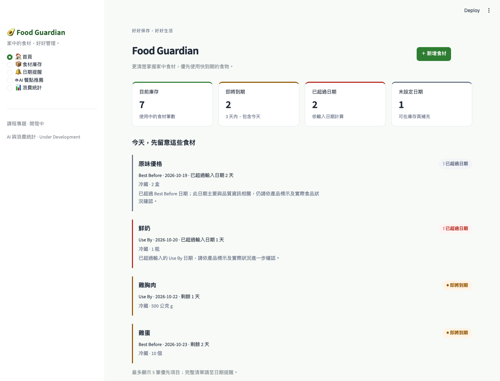
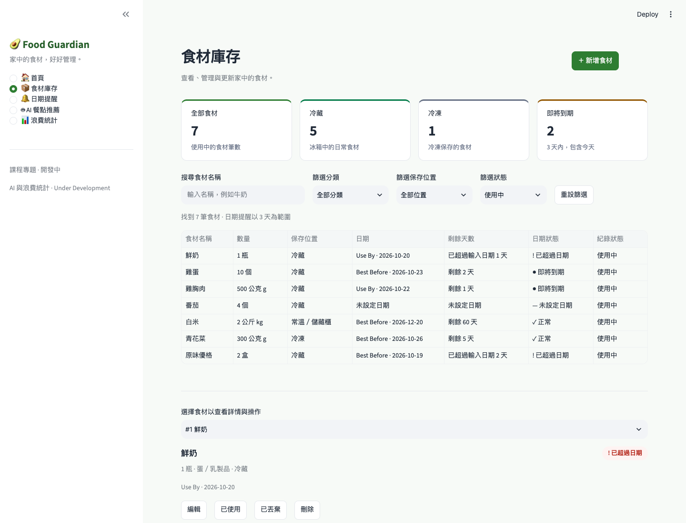
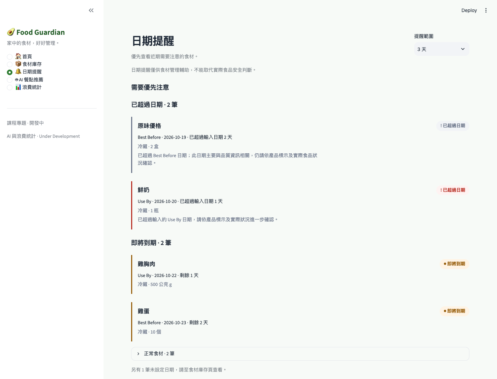
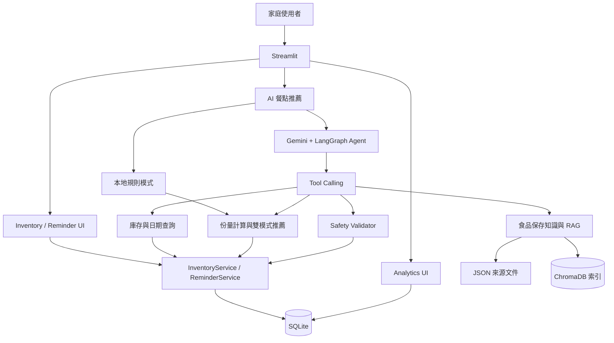

# 🥑 Food Guardian｜智慧食材管理與家庭食物浪費減量 AI Agent

> **Food Guardian: A Knowledge-Guided AI Agent for Smart Food Inventory Management and Household Food Waste Reduction**

[](https://github.com/Chen-Fanny/Food-Guardian)
[](https://www.python.org/)
[](https://streamlit.io/)
[](LICENSE)


## 📌 目錄

- [專題介紹](#-專題介紹)
- [研究動機](#-研究動機)
- [功能與目前進度](#-功能與目前進度)
- [Inventory & Reminder Module](#inventory--reminder-module)
- [Web Interface](#web-interface)
- [系統架構](#️-系統架構)
- [使用技術](#️-使用技術)
- [專案資料夾結構](#-專案資料夾結構)
- [安裝與環境設定](#-安裝與環境設定)
- [執行方式](#-執行方式)
- [Demo 展示](#-demo-展示)
- [開發進度](#️-開發進度)
- [組員分工](#-組員分工)
- [授權](#-授權)

## 📖 專題介紹

**Food Guardian** 是一套輕量化的智慧家庭食材管理 **AI Agent** 系統，旨在協助使用者記錄食材庫存、查看食品日期標示與提醒、依照現有食材取得餐點建議，以及追蹤食材使用與丟棄情況。

目前已整合 **Gemini + LangGraph Tool Calling**、SQLite 食材庫存、Python 規則式推薦、RAG 食品知識檢索與 Evaluation 測試。與直接向聊天機器人詢問食譜不同，Food Guardian 的目標是讓 AI 能透過工具查詢**實際庫存**與**既有食譜資料**，再提供可說明依據的建議。

本系統提供的食品日期資訊與保存提醒僅供輔助管理，**不能取代實際食品安全判斷**；資訊不足時應提醒使用者進一步確認，而非保證食材可安全食用。

## 💡 研究動機

家庭食物浪費不僅造成金錢損失，也代表生產、運輸與保存食品時投入的資源未被充分利用。本專題聚焦三項常見痛點：

1. **日期標示容易混淆**：消費者可能不清楚 *Use By*（依各地標示法規理解）與 *Best Before*（最佳賞味期限）等標示的差別。日期標示與食品安全不能一概而論。
2. **忘記已購買的食材**：食材放在冰箱或儲藏櫃中，可能因缺乏紀錄而被遺忘或重複購買。
3. **缺少符合庫存的餐點建議**：即使知道哪些食材需要優先處理，也不一定知道可以做什麼料理。

Food Guardian 希望透過庫存可視化、日期提醒與 AI 輔助餐點推薦，幫助使用者更有效率地利用現有食材。實際減少食物浪費的效果將留待實驗與使用紀錄驗證。

## 🚀 功能與目前進度

本專題持續開發中；**Inventory & Reminder 已有功能及測試紀錄，D 組 AI Agent 核心功能已完成實作與實測**。以下將「已實作」、「已有實測」與「仍待驗證」分開標註，避免將程式存在誤寫為整體驗收完成。

| 編號 | 功能 | 目前進度與限制 |
|---|---|---|
| 1 | 食材庫存管理 | **已實作**：SQLite CRUD、部分使用／丟棄及歷史紀錄；跨組整合仍應再驗收 |
| 2 | 日期提醒 | **已實作**：Use By / Best Before 分類、1/3/5/7 天提醒；不等同食品安全認證 |
| 3 | AI Agent 食譜推薦 | **已實作並有 Gemini Live 工具紀錄**：LangGraph、數量計算、雙模式排序、缺額解釋 |
| 4 | 食品知識與 RAG | **已建置並有功能測試**：JSON、官方來源整理及 ChromaDB；正式 RAG Live 兩題尚未完成 |
| 5 | 食品安全前置篩選 | **已實作且工具呼叫已驗證**：依 SQLite 日期標示進行 eligible/review/blocked 分類；不保證可食用 |
| 6 | 食物使用／浪費分析 | `analytics_service.py` 與分析介面存在；**完整 E 組功能與資料正確性仍待跨組驗收** |
| 7 | 系統 Evaluation | **已完成初步評估**：30 題情境、25 題離線檢查通過、3 題 Gemini Live 工具選擇通過；其餘待補 |

**實作範圍**：目前為以 Streamlit 展示的本機原型；尚無 YOLO 食材辨識、IoT 感測器、自行訓練大型模型、多家庭權限控制，也尚未證明實際減少食物浪費。**與原始提案不同，D 組已加入小型 ChromaDB 向量檢索（RAG）。**

## Inventory & Reminder Module

本模組負責 SQLite food inventory、CRUD、Consumed / Wasted 紀錄、Date Reminder，以及 Streamlit Inventory / Reminder UI。此段記錄早期庫存／提醒模組的已實作內容與測試範圍；在整合後專案中仍須進行完整人工操作驗收。

```text
Streamlit → InventoryService / ReminderService → DatabaseManager → SQLite
AI Agent → inventory_tools.py → InventoryService / ReminderService
ReminderService → InventoryService（查詢 active 庫存）
```

UI 不直接操作 SQLite，也不執行 SQL；`inventory_tools.py` 是 Service 的薄層 Adapter。Agent、Recipe、Knowledge Base 已由 D 組後續整合；Analytics 的最終功能與數據品質仍待 E 組共同確認。

### 庫存操作

- **Create / Read / Update**：新增、查詢及編輯庫存，支援分類、保存位置及狀態篩選。Category、Unit、Storage、Date Label 使用 `src/constants.py` 的固定英文值，UI 顯示中文。
- **Delete**：只用於輸入錯誤的 active 資料，採 Hard Delete；不等於吃掉或丟掉。已有 logs 會保留食材名稱、分類、數量及單位快照，`item_id` 依既有外鍵規格設為 NULL。
- **Consumed**：實際使用食材，減少庫存並新增 consumed log。
- **Wasted**：實際丟棄食材，減少庫存並新增 wasted log，可填寫 reason。

例如雞蛋 10 顆，Consumed 3 顆後剩餘 7 顆，status 仍為 active。只有剩餘 quantity = 0 時，才將 status 設為最後一次操作的 consumed / wasted。新增／編輯的 quantity 及使用／丟棄數量必須大於 0，操作不可超過庫存。

quantity = 0 且 status = consumed / wasted 時，資料為 **Completed Historical Record**：僅供查看，不允許一般 Edit、Hard Delete、Consume 或 Waste；UI 停用相關按鈕，Service 同樣拒絕操作。本版不提供 Undo / Correction，補貨請新增一筆；未來更正功能需以單一 transaction 同步處理 inventory 與 logs。

使用／丟棄以單一 transaction 更新庫存與 log；任一寫入失敗會 rollback。SQLite 的 `BEGIN IMMEDIATE` 可避免同時操作超額扣除。數量採既有 SQLite REAL；Service 使用 Decimal 計算扣除，並拒絕非有限數量。

### 日期提醒

`date_label_type` 僅包含 **Use By** 與 **Best Before**；實際開封日期 `opened_date` 為獨立欄位，不會自動推算新的到期日。`expiry_date` 可為 NULL，UI 顯示「未設定日期」，不納入提醒；填寫 expiry_date 時須選擇日期標示類型。

Reminder 預設 3 天，UI 可選 **1 / 3 / 5 / 7** 天，只計算 active 庫存：

| 條件 | 分類 |
|---|---|
| 剩餘天數 > 門檻 | normal／正常 |
| 0 ≤ 剩餘天數 ≤ 門檻（包含今天） | expiring_soon／即將到期 |
| 剩餘天數 < 0 | passed_date／已超過日期 |
| expiry_date 為 NULL | no_date／未設定日期 |

Use By 與 Best Before 顯示不同的中性提示，Best Before 提示其品質資訊性質。`get_expired_items()` 僅表示超過輸入日期，**不能取代實際食品安全判斷**，也不保證一定安全或一定不能吃。

### 資料庫與 Service

`schema.sql` 為 schema single source of truth。DatabaseManager 自動建立資料夾、重複初始化、每次連線啟用 foreign keys，並使用 sqlite3.Row。Service 透過 context manager commit / rollback 並關閉連線。

| 資料表 | 用途／欄位 |
|---|---|
| `inventory_items` | id、name、category、quantity、unit、purchase_date、expiry_date（nullable）、date_label_type、opened_date、storage_location、status、created_at、updated_at |
| `consumption_waste_logs` | 使用／丟棄紀錄；item_id、item_name、category、quantity、unit、action_type、reason、log_date、created_at |
| `recipe_recommendations` | **Optional**；原 schema 保留記錄用途，但 D 組推薦工具已實作；尚未驗證把推薦結果寫回此表 |

預設資料庫為 `data/database/food_guardian.db`；可透過 `DATABASE_PATH` 指定其他路徑。首次進入首頁／庫存／提醒頁面自動初始化，重啟使用同一檔案保留資料。此次 Repository 無舊資料庫，因此未實作舊版 schema 的 migration。

程式整合範例：

```python
from src.database.db_manager import DatabaseManager
from src.services.inventory_service import InventoryService
from src.services.reminder_service import ReminderService

db = DatabaseManager()
db.initialize_database()
inventory = InventoryService(db)
active_items = inventory.get_items(status="active")
all_items = inventory.get_items(status=None)  # 包含 completed 歷史庫存
reminders = ReminderService(inventory_service=inventory)
soon = reminders.get_expiring_soon()
```

`get_item_by_id`、update、delete、consume、waste 找不到 ID 時拋出 LookupError；無效輸入或已完成紀錄的修改拋出 ValueError。UI 將失敗顯示為錯誤訊息。`query_active_inventory(category)` 及 `query_expiring_items(days_ahead)` 供其他組員串接，後者包含今天至指定門檻，不含已超過日期及未設定日期。

### Streamlit 操作與驗證

1. 側欄選「食材庫存」，點「＋ 新增食材」開啟 dialog，依基本資料、數量、保存與日期三組欄位填寫；到期與開封日期可不填。
2. 搜尋／篩選庫存後選擇食材，以獨立 dialog 編輯、記錄已使用／已丟棄，先查看剩餘數量再確認；丟棄原因可不填。刪除輸入錯誤的資料另有確認 dialog。
3. 篩選狀態為「已使用／已丟棄」可查看 completed 紀錄，相關操作停用。
4. 側欄選「日期提醒」，選 1／3／5／7 天，先查看已超過日期，再看即將到期項目；正常食材收在折疊區，Use By／Best Before 有不同提示。
5. AI 餐點推薦已可選擇 Gemini + LangGraph 或本地規則模式；浪費統計的整合驗收仍待完成。

測試使用 pytest 的獨立 temporary SQLite database，涵蓋 CRUD、部分使用／丟棄、log、rollback、並行扣庫存、日期邊界、NULL 日期、completed 保護、重啟資料保留及 Streamlit AppTest。瀏覽器驗證亦使用 `/private/tmp` 資料庫，不污染正式資料。

主要檔案：`src/constants.py`、`src/database/schema.sql`、`src/database/db_manager.py`、`src/services/inventory_service.py`、`src/services/reminder_service.py`、`src/ui/components/inventory_view.py`、`src/ui/components/reminders_view.py`、`src/agent/tools/inventory_tools.py`、`src/utils/helpers.py`。

早期進度以 `TODO.md` 記錄；整理後分享專案未附此舊檔，正式進度以本 README 與 `docs/EVALUATION_REPORT.md` 為準。人工操作驗收尚未全部完成。

## Web Interface

採用淺色、溫暖的家庭食材 Dashboard，以綠色作為主要操作色。原生 Streamlit dialog、工具列與導覽搭配集中管理的 theme 與少量排版／badge CSS；字體使用系統 fallback，不依賴外部字體下載。

- **Sidebar Navigation**：首頁、食材庫存、日期提醒、AI 餐點推薦與浪費統計；AI 餐點推薦已可操作；浪費統計仍待整合驗收。
- **Home Dashboard**：目前庫存、即將到期、已超過日期與未設定日期，均為 active 食材的筆數；優先清單最多顯示 5 筆。
- **Inventory Dashboard / CRUD**：小型 KPI、名稱搜尋、分類／保存位置／狀態篩選與重設。精簡列表供掃視，選擇食材後查看完整資料或開啟編輯 dialog。
- **Consumed / Wasted Dialog**：輸入本次數量即顯示剩餘庫存，超額不能確認。丟棄原因顯示中文，儲存既有英文值；確認丟棄與刪除採克制的紅色樣式。
- **Date Reminder**：已超過日期優先，其次為即將到期；正常食材折疊。Best Before 使用中性提示與視覺，不當作食品安全危險判定。
- **數量調整**：新增、編輯、使用與丟棄的加減按鈕每次增減 1；仍可手動輸入小數（例如使用 0.25 kg），不會將既有庫存自動取整。
- **操作回饋**：欄位旁驗證、成功 toast、明確空畫面與可理解的錯誤訊息；不向一般使用者顯示 Python exception。
- **窄畫面**：KPI 與篩選器換行，表單縱向排列；原生資料表保留水平捲動。已於 390px、768px、1440px 寬度驗證。

原組員的 UI 需求記載 **Streamlit 1.66.0+**；正式安裝需以統一依賴檔與實際環境檢查為準。更新既有環境後，重新啟動伺服器：

```bash
pip install -r requirements.txt
streamlit run src/ui/app.py
```

以下是實際 Chromium 擷取的頁面，使用獨立暫存資料庫中的示範食材；沒有將範例資料寫入正式資料庫。

首頁 Dashboard：



食材庫存：



日期提醒：



其他實際畫面：[新增食材 dialog](docs/screenshots/add-dialog-desktop.png)、[使用數量預覽](docs/screenshots/consume-dialog-desktop.png)、[丟棄 dialog](docs/screenshots/waste-dialog-desktop.png)、[刪除確認](docs/screenshots/delete-dialog-desktop.png)、[390px 手機版庫存](docs/screenshots/inventory-390.png)、[手機版提醒](docs/screenshots/reminders-390.png)。

驗證結果：原始 UI 文件曾記錄 **83 tests passed**，涵蓋其當時的 Backend 與 UI 測試；此數字為**前期文件記錄，非本次合併專案重新執行的結果**。原始文件所提的 UI Redesign Validation 附件未包含在目前整理版，不能據此獨立重現瀏覽器測試。Backend／schema／Service API 未因 UI 重設改動；原模組的人工驗收與最新跨組整合仍待完成。

## 🏗️ 系統架構

Food Guardian 採用 Streamlit + Python Service + SQLite 的分層設計。D 組以 **Gemini + LangGraph** 為 AI Agent，引導工具讀取真實庫存、計算推薦與引用食品知識；需要時可切換本地規則模式。推薦及安全判斷的關鍵數值由 Python 工具產生，不應由 LLM 任意編造。



安全規則僅代表根據可取得的日期與已知資料進行**自動推薦前置篩選**，不等於食品安全認證。完整資料流、測試與限制見 [`DESIGN.md`](DESIGN.md) 與 [`docs/EVALUATION_REPORT.md`](docs/EVALUATION_REPORT.md)。

## 🛠️ 使用技術

| 技術 / 元件 | 用途 |
|---|---|
| Python 3.11（本機驗證環境） | 系統主要語言；實際支援版本仍需以統一 requirements 安裝結果確認 |
| Streamlit | 庫存、日期、Agent 對話與統計介面 |
| SQLite 3 | 庫存及使用／丟棄事件紀錄 |
| Gemini API、LangChain Google GenAI | LLM 與工具呼叫 |
| LangGraph | Agent 工具節點與執行流程 |
| ChromaDB、Sentence Transformers | 小型 RAG 文件向量檢索 |
| JSON Food Knowledge / Recipe Data | 食品保存文件、示範食譜與來源資料 |
| Pandas、NumPy、Plotly | 分析與視覺化 |
| Pydantic、python-dotenv | 資料結構與環境設定 |
| pytest | 自動化測試、離線與 Live Evaluation |

目前正式執行依賴以 `requirements.txt` 為準，開發及測試工具另放 `requirements-dev.txt`。是否可安裝仍須在目標環境以 `pip check` 驗證。

## 📂 專案資料夾結構

以下對應**整理後專案**的主要目錄；測試檔以功能命名，避免依版本號維護重複檔案。

```text
Food-Guardian/
├── README.md
├── DESIGN.md
├── requirements.txt
├── requirements-dev.txt
├── .env.example
├── .streamlit/config.toml
├── src/
│   ├── config.py
│   ├── constants.py
│   ├── agent/
│   │   ├── agent_core.py
│   │   ├── gemini_graph.py
│   │   ├── gemini_mode.py
│   │   └── tools/{inventory_tools,recipe_tools,knowledge_tools}.py
│   ├── database/{db_manager.py,schema.sql}
│   ├── services/{inventory_service,reminder_service,recipe_service,
│   │             portion_service,safety_service,knowledge_service,
│   │             rag_service,analytics_service}.py
│   ├── ui/app.py
│   └── ui/components/
├── data/
│   ├── database/                 # 本地 SQLite 不提交
│   ├── knowledge_base/           # 範例食譜、保存資料與來源文件
│   └── chroma_db/                # 可在本機重建索引
├── evaluation/
│   ├── cases.json
│   ├── run_evaluation.py
│   ├── retry_handler.py
│   ├── metrics.py
│   └── results/
├── scripts/build_rag_index.py
├── tests/                       # 依功能命名的測試
└── docs/
    ├── EVALUATION_REPORT.md
    ├── PRESENTATION_OUTLINE.md
    └── screenshots/
```

`.env`、真實 SQLite 與向量索引不包含在公開分享壓縮檔中。原始 README 引用的 `TODO.md`、`docs/architecture.md` 或 UI 驗證附件應以實際提交的檔案為準；**沒有隨專案附上的舊文件不應視為現有資產**。

## 💻 安裝與環境設定

以已建立的 Conda 環境為例（Windows PowerShell）：

```powershell
conda activate foodguardian
python -m pip install -r requirements-dev.txt
python -m pip check
```

若需單獨安裝正式執行依賴，使用 `python -m pip install -r requirements.txt`。

複製範例環境設定：

```powershell
Copy-Item .env.example .env
```

在**專案根目錄**的 `.env` 設定（不要將金鑰寫入 README、提交 Git 或貼在公開記錄）：

```dotenv
GOOGLE_API_KEY=填入自己的金鑰
GEMINI_MODEL=填入目前帳戶可用的模型名稱
AGENT_MODE=gemini
RAG_ENABLED=true
CHROMA_PATH=data/chroma_db
```

在 Gemini 不可使用時可選擇本地規則模式；若尚未建好索引，可先設 `RAG_ENABLED=false`。**模型名稱依 API 實際可使用結果調整，不預設所有帳戶均可使用同一模型。**

如需重建 RAG 索引：

```powershell
python scripts/build_rag_index.py
```

注意：公開 ZIP 不包含個人 `.env`、真實庫存資料庫與既有索引，必須自行保留本機資料或重建。

## 🚀 執行方式

啟動網頁：

```powershell
python -m streamlit run src/ui/app.py
```

進行功能測試與離線評估：

```powershell
python -m pytest tests -q
python evaluation/run_evaluation.py
```

需有可用的 Gemini API 金鑰，且會呼叫外部服務的 Live 多工具評估：

```powershell
python evaluation/run_evaluation.py --live --category multi_tool --limit 3 --max-retries 1
```

Live 測試可能遇到 API 503／504／429 或額度限制，請保留原始 CSV 與摘要，不要將服務失敗直接當作工具選擇錯誤。完整結果見 [`docs/EVALUATION_REPORT.md`](docs/EVALUATION_REPORT.md)。

## 🎥 Demo 展示

**狀態：AI Agent 核心 Demo 已可操作；完整團隊整合 Demo 仍待驗收。**

已經實測的 D 組對話與工具情境包括：

- **指定人數推薦**：兩人份番茄炒蛋示範食譜需番茄 2 個、雞蛋 4 個；測試庫存為番茄 2 個、雞蛋 3 個，工具計算**缺雞蛋 1 個**。
- **雙模式推薦**：`ready_now` 將數量完整的高麗菜炒蛋優先；`expiry_first` 將番茄炒蛋優先，但仍清楚指出缺料。
- **食品安全初篩**：`validate_inventory_safety_tool` 成功查詢 SQLite 的雞胸肉紀錄，回傳日期規則狀態及限制聲明。
- **多工具 Agent**：Gemini + LangGraph Live 工具呼叫已產生可審核的 Tool Trace。

既有前期 UI 截圖位於 [`docs/screenshots/`](docs/screenshots/)；最終 AI 對話截圖、完整操作影片與跨組展示仍待補充。成果數據見 [`docs/EVALUATION_REPORT.md`](docs/EVALUATION_REPORT.md)。

## 🗺️ 開發進度

- [x] **Milestone 0：Proposal 與專案初始化**：研究問題、GitHub、SQLite Schema、基本網頁骨架。
- [ ] **Milestone 1：庫存／提醒**：CRUD、日期提醒、Consumed／Wasted 已實作及有測試紀錄；最新合併版本的人工驗收尚未完成。
- [x] **Milestone 2：D 組 AI Agent 核心實作**：Gemini + LangGraph、工具查詢、本地規則模式、食譜推薦與多意圖 Tool Calling。
- [x] **Milestone 3：D 組份量與安全邏輯**：`portion_service`、`safety_service`、雙模式排序與來源限制說明。
- [ ] **Milestone 4：RAG 完整驗收**：已有 ChromaDB/JSON 文件與功能測試；兩題 Live RAG 及引用正確性人工審核仍待完成。
- [ ] **Milestone 5：資料分析與跨組驗收**：E 組 Dashboard、資料一致性與完整展示待共同確認。
- [ ] **Milestone 6：Evaluation 與成果展示**：
  - [x] 30 題情境資料集；離線 25 PASS、5 NOT_RUN。
  - [x] 最新有效 Gemini Live 3/3 PASS；1 次額外重試，成功回應平均 11.71 秒。
  - [ ] RAG Live、內容人工評分、跨組情境測試、期末 PPT 與 Demo 影片。

> **關於測試數字**：前期 README 中的 UI **83 tests passed**、整理版的測試執行紀錄與 D 組 Evaluation 的 **25 PASS / Live 3 PASS** 是不同時間、不同範圍的測試，不能加總成整體通過題數或宣稱系統整體準確率 100%。

## 📄 授權

本專案目前包含 `LICENSE` 檔案，使用 **MIT License**。第三方資料、文獻及模型須另外遵守其各自的授權與使用條款。

---


