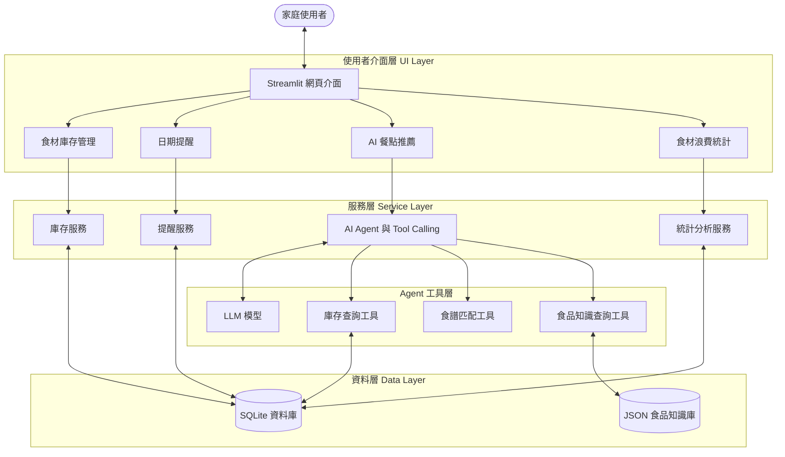

# 🥑 Food Guardian｜智慧食材管理與家庭食物浪費減量 AI Agent

> **Food Guardian: A Knowledge-Guided AI Agent for Smart Food Inventory Management and Household Food Waste Reduction**

[](https://github.com/Chen-Fanny/Food-Guardian)
[](https://www.python.org/)
[](https://streamlit.io/)
[](LICENSE)


## 📌 目錄

- [專題介紹](#-專題介紹)
- [研究動機](#-研究動機)
- [預計實作功能](#-預計實作功能)
- [系統架構](#️-系統架構)
- [使用技術](#️-使用技術)
- [專案資料夾結構](#-專案資料夾結構)
- [安裝與環境設定](#-安裝與環境設定)
- [執行方式](#-執行方式)
- [Demo 展示](#-demo-展示)
- [開發進度](#️-開發進度)
- [組員分工](#-組員分工)
- [授權](#-授權)

## 📖 專題介紹

**Food Guardian** 是一套輕量化的智慧家庭食材管理 **AI Agent** 系統，旨在協助使用者記錄食材庫存、查看食品日期標示與提醒、依照現有食材取得餐點建議，以及追蹤食材使用與丟棄情況。

本專題預計結合 **大型語言模型（LLM）與 Tool Calling**、食材資料庫、Python 資料分析，以及小型食品保存知識庫。與直接向聊天機器人詢問食譜不同，Food Guardian 的目標是讓 AI 能透過工具查詢**實際庫存**與**既有食譜資料**，再提供可說明依據的建議。

本系統提供的食品日期資訊與保存提醒僅供輔助管理，**不能取代實際食品安全判斷**；資訊不足時應提醒使用者進一步確認，而非保證食材可安全食用。

## 💡 研究動機

家庭食物浪費不僅造成金錢損失，也代表生產、運輸與保存食品時投入的資源未被充分利用。本專題聚焦三項常見痛點：

1. **日期標示容易混淆**：消費者可能不清楚 *Use By*（依各地標示法規理解）與 *Best Before*（最佳賞味期限）等標示的差別。日期標示與食品安全不能一概而論。
2. **忘記已購買的食材**：食材放在冰箱或儲藏櫃中，可能因缺乏紀錄而被遺忘或重複購買。
3. **缺少符合庫存的餐點建議**：即使知道哪些食材需要優先處理，也不一定知道可以做什麼料理。

Food Guardian 希望透過庫存可視化、日期提醒與 AI 輔助餐點推薦，幫助使用者更有效率地利用現有食材。實際減少食物浪費的效果將留待實驗與使用紀錄驗證。

## 🚀 預計實作功能

目前處於 **Proposal 階段**；以下功能尚未全部完成。

| 編號 | 功能 | 說明 | 狀態 |
|---|---|---|---|
| 1 | **食材庫存管理** | 新增、查看、修改、刪除食材；記錄數量、保存位置與日期資訊 | `Planned` |
| 2 | **食材日期提醒** | 依使用者輸入的日期及標示類型提供提醒，不直接判定食品安全 | `Planned` |
| 3 | **AI Agent 食譜推薦** | 透過 LLM Tool Calling 查詢庫存、搜尋食譜並說明推薦原因 | `Planned` |
| 4 | **基本食品知識查詢** | 查詢整理自可靠來源的小型 JSON 食品保存知識庫 | `Planned` |
| 5 | **使用與浪費統計** | 使用 Pandas 統計食材使用及丟棄紀錄，產生圖表 | `Planned` |

**實作範圍：** 優先完成可操作的 Web Demo、資料查詢及推薦結果；本階段不包含 YOLO 食材辨識、IoT 感測器、大型 RAG 向量資料庫或自行訓練大型模型。

## 🏗️ 系統架構

Food Guardian 採用分層、模組化架構，便於組員分工。AI Agent 負責理解問題與呼叫工具；資料查詢、日期計算與統計由 Python 模組執行。



詳細設計請參閱 `docs/architecture.md`；正式的 `DESIGN.md` 將由組員於 Proposal 階段建立並持續更新。

## 🛠️ 使用技術

| 技術 / 元件 | 用途 |
|---|---|
| **Python 3.10+** | 系統主要程式語言 |
| **Streamlit** | 食材管理、對話介面與統計圖表的網頁 UI |
| **SQLite 3** | 食材庫存、使用與丟棄紀錄的本地資料庫 |
| **Pandas / NumPy** | 資料清理、使用量與浪費紀錄統計 |
| **LLM + Tool Calling** | 自然語言理解、查詢工具選擇與餐點推薦解釋 |
| **JSON Knowledge Base** | 儲存食品保存基本知識與來源資訊 |
| **Plotly** | 在 Streamlit 中呈現互動式分析圖表 |

## 📂 專案資料夾結構

以下為初始化的主要目錄；程式骨架不代表功能已實作完成。

```text
Food-Guardian/
├── data/
│   ├── database/                  # SQLite 本地資料（正式資料庫檔案不提交）
│   │   └── .gitkeep
│   └── knowledge_base/            # 食品領域知識
│       └── food_knowledge.sample.json
├── docs/
│   └── architecture.md            # 系統架構與設計草稿
├── src/
│   ├── config.py                  # 專案環境設定
│   ├── agent/
│   │   ├── agent_core.py          # AI Agent 核心（待開發）
│   │   └── tools/
│   │       ├── inventory_tools.py # 庫存查詢工具
│   │       ├── recipe_tools.py    # 食譜查詢工具
│   │       └── knowledge_tools.py # 知識查詢工具
│   ├── database/
│   │   ├── db_manager.py          # SQLite 連線與管理
│   │   └── schema.sql             # 資料表結構
│   ├── services/
│   │   ├── inventory_service.py   # 庫存新增／查詢／修改／刪除
│   │   ├── reminder_service.py    # 日期提醒
│   │   ├── recipe_service.py      # 食譜匹配
│   │   ├── knowledge_service.py   # 食品知識查詢
│   │   └── analytics_service.py   # 庫存與浪費統計
│   ├── ui/
│   │   ├── app.py                 # Streamlit 程式進入點
│   │   └── components/
│   │       ├── inventory_view.py
│   │       ├── agent_chat_view.py
│   │       ├── reminders_view.py
│   │       └── analytics_view.py
│   └── utils/
│       └── helpers.py             # 日期等共用工具
├── tests/
│   └── test_placeholder.py        # 測試骨架
├── .env.example                   # 環境變數範例；不包含真實金鑰
├── .gitignore                     # 排除金鑰、虛擬環境等檔案
├── requirements.txt               # Python 套件需求
├── LICENSE                        # MIT 授權
└── README.md                      # 本說明文件
```

## 💻 安裝與環境設定

> **注意：** 專案仍在 Proposal 階段，以下是目前規劃的環境設定程序；部分功能尚未能完整執行。

### 1. 下載專案（Clone）

```bash
git clone https://github.com/Chen-Fanny/Food-Guardian.git
cd Food-Guardian
```

### 2. 建立 Python 虛擬環境

macOS / Linux：

```bash
python3 -m venv venv
source venv/bin/activate
```

Windows PowerShell：

```powershell
python -m venv venv
.\venv\Scripts\Activate.ps1
```

### 3. 安裝套件

```bash
pip install --upgrade pip
pip install -r requirements.txt
```

### 4. 設定環境變數

macOS / Linux：

```bash
cp .env.example .env
```

Windows PowerShell：

```powershell
Copy-Item .env.example .env
```

依照 `.env.example` 的欄位填寫本機 API 金鑰（例如 `OPENAI_API_KEY`，實際取決於後續使用的 LLM 服務）。**請勿將 `.env` 或真實 API Key 上傳至 GitHub。**

## 🚀 執行方式

> 目前 `src/ui/app.py` 是專案介面的初始骨架，**尚非完整可用系統**。

啟動 Streamlit：

```bash
streamlit run src/ui/app.py
```

執行測試：

```bash
pytest tests/
```

## 🎥 Demo 展示

**狀態：開發中（Under Development）**

正式的系統操作畫面、示範影片及實驗結果，將於完成主要功能後補上。

- Demo 影片：`待補`
- 系統截圖：`待補`
- 實驗結果：`待補`

## 🗺️ 開發進度

- [x] **Milestone 0：Proposal 與專案初始化**
  - [x] 確立研究問題、預定功能與技術方向
  - [x] 建立 GitHub Repository、README 與模組化程式骨架
  - [x] 建立初版 SQLite Schema 與食品知識範例格式
- [ ] **Milestone 1：庫存與資料庫功能**
  - [ ] 實作食材新增／查詢／修改／刪除
  - [ ] 實作日期提醒
  - [ ] 完成 Streamlit 庫存管理介面
- [ ] **Milestone 2：食品知識與 AI Agent**
  - [ ] 完成 JSON 知識查詢工具
  - [ ] 實作 LLM Tool Calling
  - [ ] 實作依庫存推薦食譜與推薦理由
- [ ] **Milestone 3：數據分析與成果展示**
  - [ ] 完成食材使用與丟棄紀錄統計
  - [ ] 完成統計 Dashboard
  - [ ] 進行 Baseline 比較與測試
  - [ ] 製作 Final PPT、Demo 影片與最終文件

## 👥 組員分工

本專題共 **5 位組員**。以下以 A～E 表示正式分工角色，後續可再補上組員姓名。

| 成員 | 階段／角色 | 主要負責工作 |
|---|---|---|
| **A（Proposal）** | 研究文件與 GitHub 初始化 | Proposal Document、建立 GitHub Repository 與 README 初版 |
| **B（Proposal／Final）** | 簡報與技術文件統整 | Proposal PPT、`DESIGN.md` 初版、Final PPT 與 Final Video 統整及上傳 |
| **C（Final）** | 系統介面與資料庫 | Streamlit、SQLite、食材管理、日期提醒、系統整合與 `README.md` 後續更新 |
| **D（Final）** | AI Agent 與推薦 | LLM、Tool Calling、食譜推薦、食品知識庫與 Agent 功能測試 |
| **E（Final）** | 資料分析與實驗 | Pandas、Dashboard、Baseline 比較、Evaluation Metrics、Experiments、Conclusion |

C、D、E 分別提供自己的程式、展示素材與技術說明；B 統整 Final PPT 和影片。全體組員共同檢查最終繳交內容。以上為**預定分工**，實際貢獻將依完成情況更新。

## 📄 授權

本專案目前包含 `LICENSE` 檔案，使用 **MIT License**。第三方資料、文獻及模型須另外遵守其各自的授權與使用條款。

---

## 📄 License

This project is licensed under the [MIT License](LICENSE) — see the LICENSE file for details.
