# Food Guardian 🥑

> **A Knowledge-Guided AI Agent for Smart Food Inventory Management and Household Food Waste Reduction**

[](https://github.com/Chen-Fanny/Food-Guardian)
[](https://www.python.org/)
[](https://streamlit.io/)
[](LICENSE)

---

## 📌 Table of Contents
- [Project Overview](#-project-overview)
- [Motivation](#-motivation)
- [Planned Features](#-planned-features)
- [System Architecture](#-system-architecture)
- [Technology Stack](#-technology-stack)
- [Project Structure](#-project-structure)
- [Installation (Setup Guide)](#-installation-setup-guide)
- [How to Run](#-how-to-run)
- [Demo](#-demo)
- [Development Roadmap](#-development-roadmap)
- [Team Contributions](#-team-contributions)
- [License](#-license)

---

## 📖 Project Overview

**Food Guardian** is a lightweight, knowledge-guided AI Agent system designed to help households efficiently manage food inventory, monitor food date labels (*Use By* vs. *Best Before*), recommend practical recipes tailored to available ingredients, and track food waste patterns over time.

By integrating an AI Agent equipped with tool-calling capabilities and a curated food knowledge base, Food Guardian bridges the gap between passive inventory logging and active, intelligent household decision support.

---

## 💡 Motivation

Household food waste represents a significant environmental, economic, and resource challenge:
- **Misunderstood Date Labels**: Consumers often discard edible food due to confusion between safety-critical (*Use By*) and quality-oriented (*Best Before*) indicators.
- **Forgotten Inventory**: Groceries purchased in bulk are frequently hidden in refrigerators or pantries until they spoil.
- **Lack of Decision Support**: When ingredients approach expiration, consumers often lack quick, practical recipe ideas that utilize what they already have without requiring additional grocery runs.

**Food Guardian** addresses these pain points by offering an autonomous, knowledge-grounded assistant that provides timely alerts, demystifies date guidelines, and generates tailored culinary solutions to minimize avoidable waste.

---

## 🚀 Planned Features

The project is currently in the **Proposal Stage**. Features are categorized and labeled according to their implementation status:

| # | Feature Category | Description | Status |
|---|------------------|-------------|:------:|
| 1 | **Food Inventory Management** | Full CRUD capabilities (Create, Read, Update, Delete) to track ingredients, quantities, locations (fridge, freezer, pantry), and entry dates. | `[Planned]` |
| 2 | **Food Date Reminders** | Proactive warning system tracking shelf life, differentiating *Use By* vs. *Best Before*, and highlighting items nearing expiration. | `[Planned]` |
| 3 | **AI Agent Recipe Recommendations** | Tool-calling LLM agent that synthesizes available expiring items into actionable, zero-waste recipes. | `[Planned]` |
| 4 | **Basic Food Knowledge Retrieval** | Grounded retrieval from a structured JSON food knowledge base for optimal storage methods, shelf-life estimation, and spoilage indicators. | `[Planned]` |
| 5 | **Usage & Waste Analytics** | Data-driven dashboards utilizing Pandas to visualize household consumption rates, waste causes, and estimated savings over time. | `[Planned]` |

---

## 🏗️ System Architecture

Food Guardian follows a layered, modular architecture enabling clean separation between the user interface, business services, agent reasoning loop, and persistence layers.

```mermaid
flowchart TD
    User([Household User]) <--> UI[Streamlit UI Interface]

    subgraph Presentation Layer [UI Layer]
        UI --> ViewInv[Inventory View]
        UI --> ViewRemind[Date Reminders View]
        UI --> ViewAgent[AI Agent Advisor View]
        UI --> ViewAnalytics[Waste Analytics View]
    end

    subgraph Service Layer [Core Logic]
        ViewInv --> SvcInv[Inventory Service]
        ViewRemind --> SvcRemind[Reminder Service]
        ViewAgent --> AgentCore[AI Agent Core & Tool Calling Router]
        ViewAnalytics --> SvcAnalytics[Analytics Service]
    end

    subgraph Agent Tools [LLM Tool Calling Framework]
        AgentCore <--> LLMModel[LLM Provider]
        AgentCore --> ToolInv[Inventory Tool]
        AgentCore --> ToolRecipe[Recipe Matching Tool]
        AgentCore --> ToolKB[Knowledge Retrieval Tool]
    end

    subgraph Data Layer [Persistence & Knowledge]
        SvcInv <--> SQLiteDB[(SQLite Database)]
        ToolInv <--> SQLiteDB
        SvcRemind <--> SQLiteDB
        SvcAnalytics <--> SQLiteDB
        ToolKB <--> FoodKB[(JSON Food Knowledge Base)]
    end
```



---

## 🛠️ Technology Stack

| Layer / Role | Technology | Purpose & Rationale |
|---|---|---|
| **Programming Language** | **Python 3.10+** | Core runtime for backend services, data analysis, and AI agent logic. |
| **User Interface** | **Streamlit** | Rapid, interactive web interface for inventory tracking, chat, and metrics visualization. |
| **Data Storage** | **SQLite 3** | Lightweight, zero-configuration relational database ideal for household-scale local data. |
| **Data Processing & Analytics** | **Pandas & NumPy** | Fast data aggregation, log filtering, and waste trend analytics. |
| **AI Agent & Tool Calling** | **LLM with Function/Tool Calling** | Structured tool execution for contextual inventory queries and recipe synthesis. |
| **Knowledge Base** | **JSON** | Schema-validated, transparent repository of food preservation techniques and shelf-life metrics. |
| **Visualizations** | **Plotly** | Dynamic, interactive charts embedded in Streamlit for waste analytics. |

---

## 📂 Project Structure

```text
Food-Guardian/
├── .github/                     # GitHub workflows and project templates (Planned)
├── data/
│   ├── database/                # Local SQLite database files (git-ignored)
│   │   └── .gitkeep
│   └── knowledge_base/          # Structured domain knowledge
│       └── food_knowledge.sample.json
├── docs/                        # Architecture diagrams and design specifications
│   └── architecture.md
├── src/
│   ├── __init__.py
│   ├── config.py                # Environment and configuration settings
│   ├── agent/                   # AI Agent logic and Tool Calling definitions
│   │   ├── __init__.py
│   │   ├── agent_core.py        # Agent loop and prompt management
│   │   └── tools/               # Modular tool definitions for the LLM
│   │       ├── __init__.py
│   │       ├── inventory_tools.py
│   │       ├── recipe_tools.py
│   │       └── knowledge_tools.py
│   ├── database/                # Database connection and DDL schema
│   │   ├── __init__.py
│   │   ├── db_manager.py
│   │   └── schema.sql
│   ├── services/                # Business logic services
│   │   ├── __init__.py
│   │   ├── inventory_service.py
│   │   ├── reminder_service.py
│   │   ├── recipe_service.py
│   │   ├── knowledge_service.py
│   │   └── analytics_service.py
│   ├── ui/                      # Streamlit frontend views and components
│   │   ├── __init__.py
│   │   ├── app.py               # Main Streamlit application entrypoint
│   │   └── components/
│   │       ├── __init__.py
│   │       ├── inventory_view.py
│   │       ├── agent_chat_view.py
│   │       ├── reminders_view.py
│   │       └── analytics_view.py
│   └── utils/                   # Shared utility helpers (date calculations, parsing)
│       ├── __init__.py
│       └── helpers.py
├── tests/                       # Automated tests (Pytest)
│   ├── __init__.py
│   └── test_placeholder.py
├── .env.example                 # Template for environment variables and API keys
├── .gitignore                   # Git ignore patterns for Python, SQLite, and secrets
├── requirements.txt             # Project dependencies
└── README.md                    # Project documentation
```

---

## 💻 Installation (Setup Guide)

> [!NOTE]
> The project is currently in the **Proposal Stage**. The installation commands below serve as the planned environment setup.

### 1. Clone the Repository
```bash
git clone https://github.com/Chen-Fanny/Food-Guardian.git
cd Food-Guardian
```

### 2. Create and Activate a Virtual Environment
```bash
# On macOS/Linux:
python3 -m venv venv
source venv/bin/activate

# On Windows (PowerShell):
python -m venv venv
.\venv\Scripts\Activate.ps1
```

### 3. Install Dependencies
```bash
pip install --upgrade pip
pip install -r requirements.txt
```

### 4. Configure Environment Variables
Copy `.env.example` to create your local `.env` configuration file:
```bash
# On Linux/macOS:
cp .env.example .env

# On Windows (PowerShell):
Copy-Item .env.example .env
```
Update `.env` with your API credentials (e.g., `OPENAI_API_KEY`) and preferred database paths.

---

## 🚀 How to Run

> [!NOTE]
> Full application modules are currently under development. The entrypoint currently hosts a project scaffold preview.

To launch the preliminary Streamlit application:
```bash
streamlit run src/ui/app.py
```

To run test suites:
```bash
pytest tests/
```

---

## 🎥 Demo

> [!IMPORTANT]
> **Status: Under Development**
>
> Because the project is currently in the proposal and architecture specification phase, visual demonstrations, screenshots, and live demo links are not yet published. Demo recordings and walkthrough GIFs will be added here upon completion of Milestone 2.

```
[Placeholder: Demo Video / Screenshot Walkthrough - Coming in Milestone 2]
```

---

## 🗺️ Development Roadmap

- [x] **Milestone 0: Proposal & Architecture Initialization** *(Current)*
  - [x] Problem formulation and technical feasibility assessment
  - [x] Repository setup, project scaffold, and modular architecture definition
  - [x] Initial SQLite schema definition and sample food knowledge base schema
- [ ] **Milestone 1: Core Inventory & Database Integration** `[Planned]`
  - [ ] Implement SQLite CRUD database operations (`InventoryService`)
  - [ ] Implement expiration reminder calculations (`ReminderService`)
  - [ ] Build interactive Streamlit inventory management dashboard
- [ ] **Milestone 2: Knowledge Base & AI Agent Tool Calling** `[Planned]`
  - [ ] Implement JSON food knowledge retriever (`KnowledgeService`)
  - [ ] Build AI Agent loop with function/tool calling (`FoodGuardianAgent`)
  - [ ] Implement expiring-item recipe recommendation tools
- [ ] **Milestone 3: Analytics Dashboard & Household Evaluation** `[Planned]`
  - [ ] Develop consumption and waste tracking module (`AnalyticsService`)
  - [ ] Implement interactive Plotly analytics dashboard
  - [ ] Comprehensive system testing and project presentation

---

## 👥 Team Contributions

This repository hosts a University AI Agent Final Project developed cooperatively by team members:

| Team Member | Role | Primary Planned Responsibilities |
|---|---|---|
| **Member 1** *(Lead)* | System Architecture & AI Agent | Agent core logic, prompt design, LLM tool calling integration. |
| **Member 2** | UI / Frontend Development | Streamlit dashboard layout, inventory management views, chat UX. |
| **Member 3** | Backend Services & Database | SQLite schema, CRUD operations, date reminder calculations. |
| **Member 4** | Knowledge Base & Analytics | Food knowledge curation, Pandas waste analytics, evaluation metrics. |

*(Note: Roles and assignments will be finalized as sprint planning commences.)*

---

## 📄 License

This project is licensed under the [MIT License](LICENSE) — see the LICENSE file for details.
