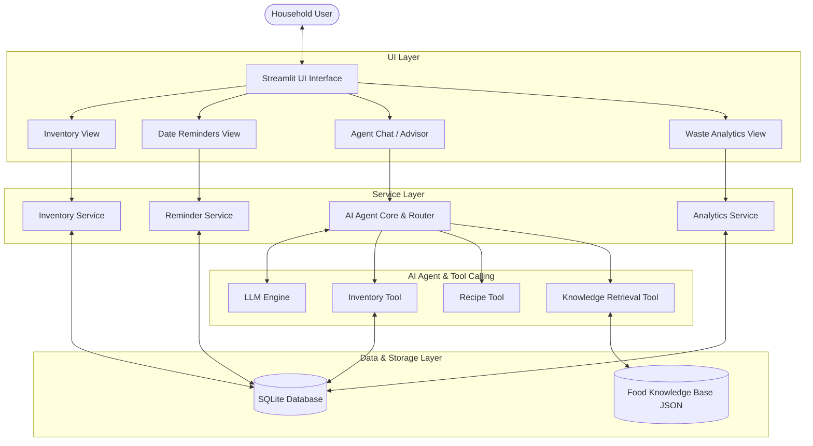

# System Architecture Specification

## 1. High-Level Architecture Overview

Food Guardian adopts a modular, tiered architecture combining a lightweight Python frontend, SQLite storage, and a Knowledge-Guided AI Agent with tool-calling capabilities.

## 2. Component Specifications

### 2.1 UI Layer (Streamlit)
- Interactive web interface presenting food inventory tables, expiration warnings, AI interactive chat, and waste trend charts.

### 2.2 Service Layer
- **Inventory Service**: Manages CRUD actions on household groceries.
- **Reminder Service**: Monitors date labels (*Use By*, *Best Before*) and marks critical items.
- **Recipe Service**: Generates zero-waste recipe options matching in-stock expiring items.
- **Knowledge Service**: Ingests storage preservation advice from curated JSON.
- **Analytics Service**: Computes food utilization rates and waste logs using Pandas.

### 2.3 Knowledge-Guided AI Agent
- Uses LLM function calling to look up real-time inventory and food storage rules, preventing hallucinations regarding ingredient availability and expiration dates.
