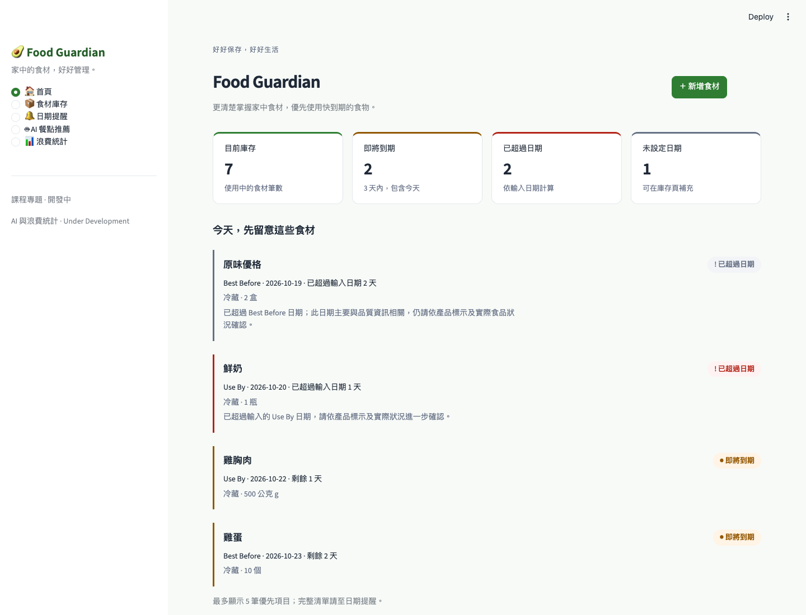
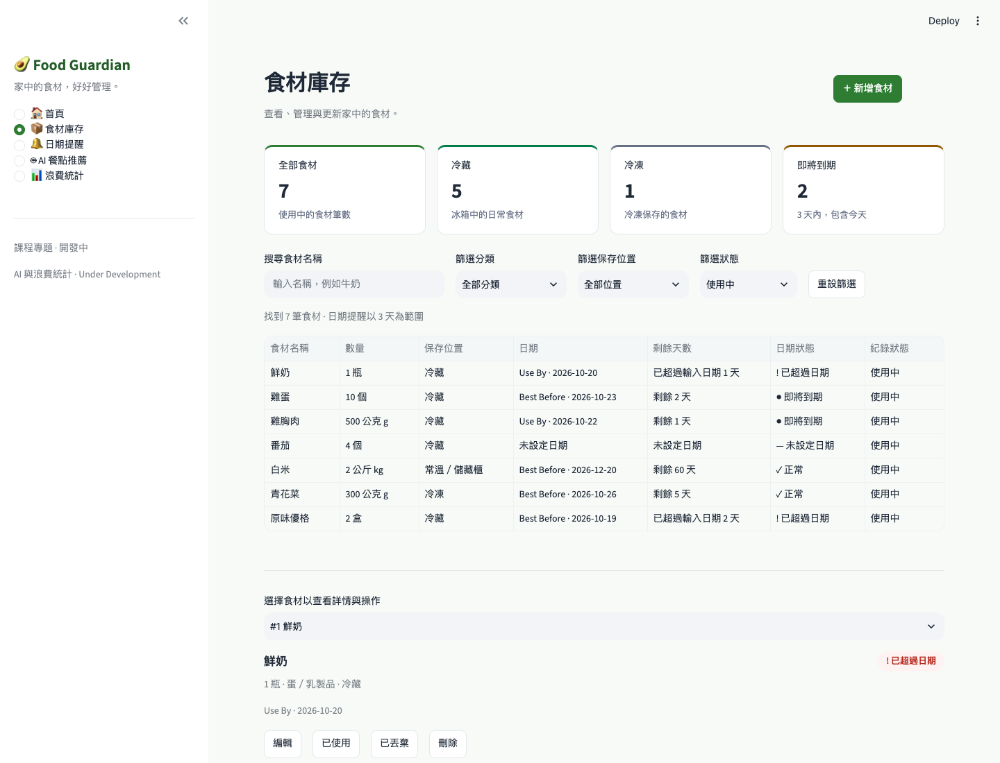
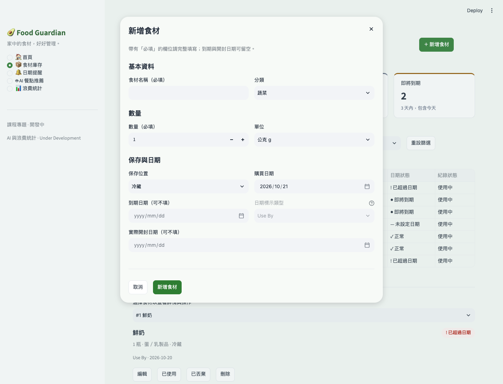
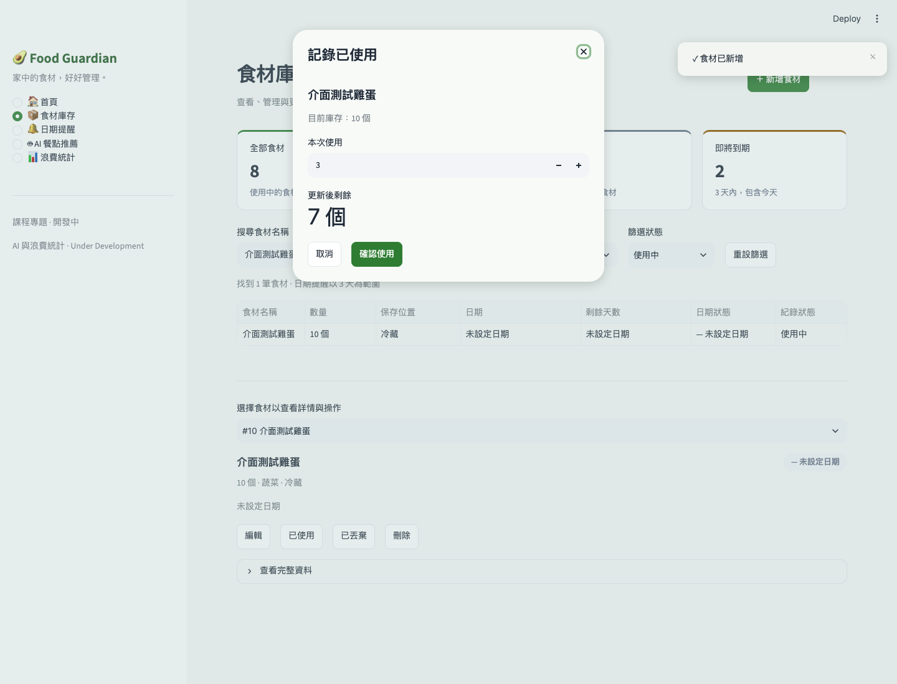
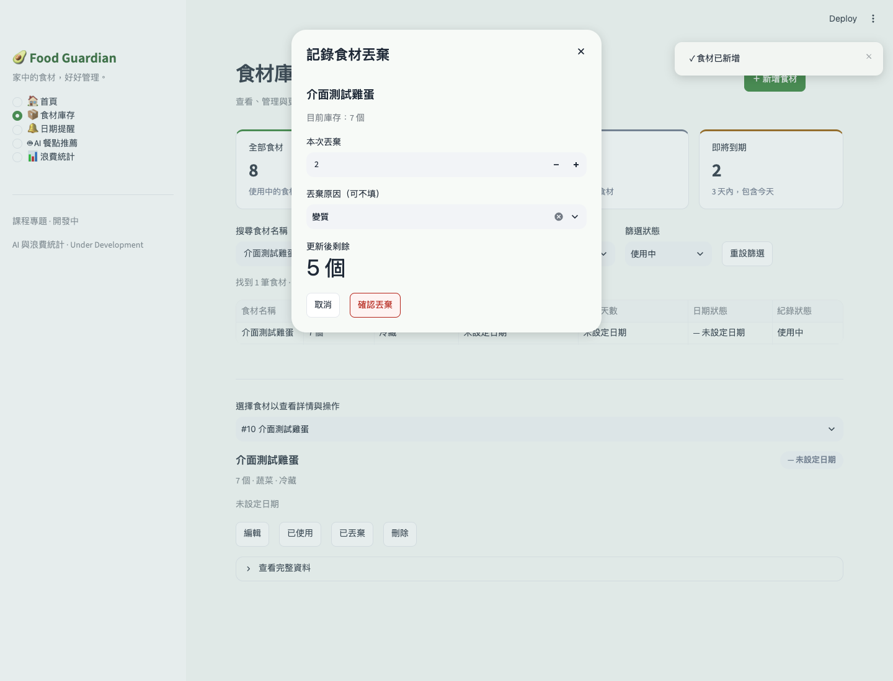
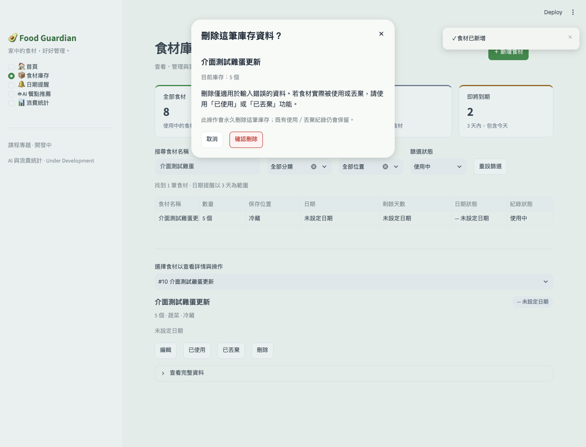
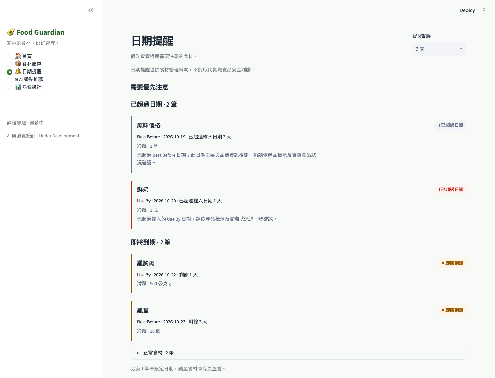
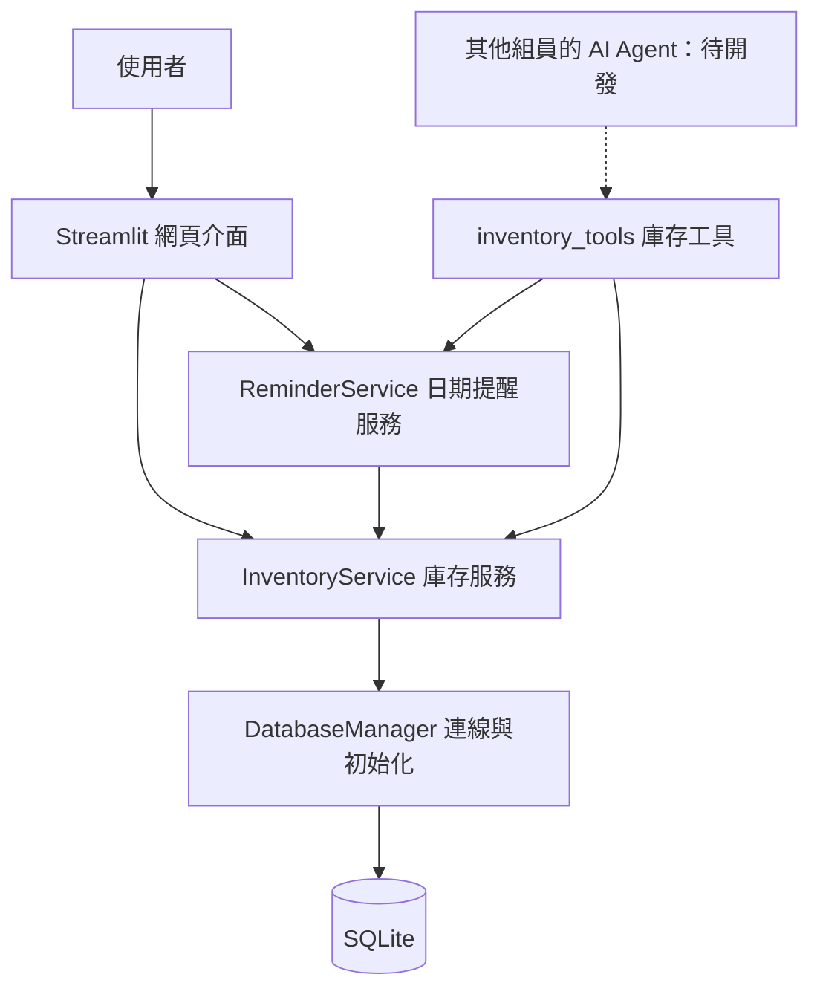

# Food Guardian：食材庫存與日期提醒模組

本文件介紹我負責實作的 Streamlit 網頁介面、SQLite 庫存管理、食材 CRUD、使用／丟棄紀錄、日期提醒，以及資料庫與其他模組的整合方式。

本模組目前可在本機啟動與操作。AI Agent 核心、食譜推薦、食品知識查詢與浪費統計仍由其他模組負責，尚未完成的頁面保留開發中提示。本文件不代表整個 Food Guardian 專案已完成。

## 一、我的實作範圍

| 項目 | 實作內容 |
|---|---|
| Streamlit 網頁介面 | Sidebar 導覽、首頁 Dashboard、庫存管理頁與日期提醒頁 |
| SQLite 資料庫 | 資料表設計、資料夾與資料表初始化、連線管理及外鍵設定 |
| 食材 CRUD | 新增、查詢、編輯與刪除輸入錯誤的庫存 |
| 使用／丟棄 | 扣除部分數量、保留剩餘庫存、產生紀錄及保護已完成的歷史資料 |
| 日期提醒 | 計算剩餘天數、分類日期狀態、區分 Use By 與 Best Before |
| 模組整合 | UI 與 Agent 庫存工具統一透過 Service 取得資料 |
| 介面設計 | 淺色主題、KPI、搜尋篩選、操作視窗、狀態標籤與操作回饋 |
| 操作文件 | 本模組的架構、功能、資料表、執行方式與電腦版畫面 |

## 二、網頁功能介紹

### 首頁 Dashboard

首頁整理家中的庫存狀態，提供「新增食材」、庫存頁與提醒頁入口。

四個摘要指標為：

- **目前庫存**：使用中的食材筆數。
- **即將到期**：輸入日期在今天至未來 3 天內的使用中食材筆數。
- **已超過日期**：已超過使用者輸入日期的使用中食材筆數。
- **未設定日期**：尚未填寫到期日期的使用中食材筆數。

這些數字計算的是食材紀錄筆數，不會將公斤、毫升、個數等不同單位直接相加。下方最多顯示 5 筆優先提醒，先列已超過日期，再列即將到期的食材。



### 食材庫存管理

庫存頁提供名稱搜尋、分類、保存位置與紀錄狀態篩選，也可一鍵重設篩選。列表呈現名稱、數量、保存位置、日期、剩餘天數與狀態；選擇食材後可查看完整資料及執行操作。

| 操作 | 功能 |
|---|---|
| 新增 | 填寫名稱、分類、數量、單位、保存位置與日期資訊 |
| 查詢 | 查看目前庫存及已使用／已丟棄的歷史紀錄 |
| 編輯 | 修改使用中食材的資料 |
| 刪除 | 經確認後，永久刪除輸入錯誤的使用中庫存 |
| 已使用 | 記錄本次實際使用的數量，扣除庫存並建立使用紀錄 |
| 已丟棄 | 記錄本次丟棄的數量及原因，扣除庫存並建立丟棄紀錄 |

分類、單位、保存位置與日期標示使用固定選項；資料庫儲存英文值，網頁顯示繁體中文。狀態同時以文字與顏色表示，避免只能靠顏色辨識。



### 新增與編輯視窗

表單分成「基本資料」、「數量」、「保存與日期」三組，透過獨立視窗集中操作，不會永久占據庫存頁面。

- 食材名稱不可空白，數量必須大於 0。
- 到期日期與實際開封日期可不填。
- 未填到期日期時，不需要選擇日期標示類型。
- 數量的加減按鈕每次增減 **1**；仍可手動輸入小數，例如 0.25 kg。
- 取消會關閉視窗，不儲存本次輸入。
- 欄位錯誤會顯示修正提示，成功後顯示簡短通知。



### 記錄已使用與已丟棄

兩種操作都支援部分數量。視窗會顯示目前庫存、本次數量與更新後剩餘數量；數量超過庫存時，不能確認操作。

例如雞蛋原有 10 個：

| 操作 | 剩餘數量 | 庫存狀態 | 新增紀錄 |
|---|---:|---|---|
| 使用 3 個 | 7 | 使用中 | 已使用 3 個 |
| 再丟棄 2 個 | 5 | 使用中 | 已丟棄 2 個 |
| 最後使用 5 個 | 0 | 已使用 | 已使用 5 個 |

丟棄原因可不填，也可選擇過期、變質、購買過量、料理過量或其他。確認丟棄使用較克制的紅色樣式，與一般新增操作區分。





### 刪除與歷史紀錄保護

刪除僅用於輸入錯誤，例如不小心重複新增一筆食材；真正使用或丟棄食材時，應使用對應的紀錄功能。

- 刪除採 **Hard Delete**，一定會先開啟確認視窗。
- 若該筆庫存已有使用／丟棄紀錄，紀錄中的名稱、分類、數量與單位快照會保留，關聯的 `item_id` 設為 NULL。
- 當剩餘數量為 0，且狀態為 consumed 或 wasted，該筆資料成為已完成的歷史紀錄。
- 已完成紀錄僅供查看，不能再編輯、刪除、使用或丟棄；UI 與 Service 都會限制。
- 本版未提供復原／更正紀錄功能。



### 日期提醒

提醒頁預設範圍為 **3 天**，可改為 **1／3／5／7 天**。頁面優先顯示已超過日期的食材，其次為即將到期的食材；正常食材收在折疊區。

| 日期條件 | 分類與顯示方式 |
|---|---|
| 剩餘天數大於提醒範圍 | 正常 |
| 剩餘天數介於 0 與提醒範圍之間，包含今天 | 即將到期 |
| 剩餘天數小於 0 | 已超過日期 |
| 未填寫到期日期 | 未設定日期，不列入日期提醒 |

提醒只針對使用中的庫存。`opened_date` 是實際開封日期的獨立欄位，不會自動推算新的到期日。

**Use By 與 Best Before 的呈現不同**：Use By 保持較明確的日期提醒；Best Before 採中性視覺，說明其品質資訊性質。系統僅協助日期管理，不能取代實際食品安全判斷，不會直接宣稱食材一定安全或一定不能吃。



> 本文件的截圖為實際系統畫面，使用獨立暫存資料庫中的示範食材；圖片中的資料不是預設正式庫存。畫面主要展示操作流程，數量欄位的加減按鈕目前已調整為每次增減 1。

## 三、模組架構介紹

本模組沿用專案的分層架構，讓畫面、資料操作與資料庫連線各自負責明確的工作。



| 層級 | 負責內容 |
|---|---|
| Streamlit UI | 畫面、表單、搜尋篩選、操作確認、輸入提示與狀態呈現 |
| InventoryService | 食材 CRUD、資料驗證、使用／丟棄數量檢查與交易 |
| ReminderService | 取得使用中庫存、計算剩餘天數及日期提醒分類 |
| DatabaseManager | 開啟與關閉連線、執行 schema、啟用外鍵、提交或回復交易 |
| SQLite | 持久保存庫存與使用／丟棄紀錄 |
| inventory_tools | 提供其他組員使用的庫存查詢介面，委派給 Service |

### 設計重點

1. **UI 不直接寫 SQL**：新增、修改、刪除與庫存扣除都透過 InventoryService；日期提醒透過 ReminderService。
2. **庫存邏輯集中管理**：其他模組使用既有 Service，避免各自撰寫另一套庫存 SQL。
3. **Schema 集中管理**：資料表定義放在 `schema.sql`，不在 Python 重複硬寫資料表結構。
4. **使用／丟棄維持一致性**：先檢查庫存，再更新數量及狀態、寫入 log；整個操作使用同一筆 transaction，失敗時 rollback。
5. **避免同時超額扣除**：使用／丟棄交易以 `BEGIN IMMEDIATE` 保護讀取與更新流程。
6. **歷史紀錄由兩層保護**：UI 停用按鈕，Service 也拒絕修改已完成紀錄。
7. **固定選項共用**：分類、單位、保存位置與中文標籤集中於 `src/constants.py`。
8. **樣式集中管理**：Streamlit Theme 與少量共用 CSS／呈現 helper 維持視覺一致。

## 四、資料庫介紹

預設資料庫位置為專案根目錄下的：

```text
data/database/food_guardian.db
```

首次進入首頁、庫存或提醒頁時自動初始化資料夾與資料表；重複初始化不會清空資料。關閉再重新啟動網頁，使用相同資料庫路徑即可保留原有庫存。

每次連線啟用 SQLite foreign keys，查詢結果使用 `sqlite3.Row`。連線透過 context manager 在操作後關閉。

### `inventory_items`：食材庫存

| 欄位 | 說明 |
|---|---|
| `id` | 食材識別編號 |
| `name` | 食材名稱 |
| `category` | 固定食材分類 |
| `quantity` | 剩餘數量，沿用 REAL 儲存以支援重量與容量小數 |
| `unit` | 固定單位，例如 piece、g、kg、ml |
| `purchase_date` | 購買日期 |
| `expiry_date` | 到期日期，可為 NULL |
| `date_label_type` | use_by 或 best_before，可在沒有日期時留空 |
| `opened_date` | 實際開封日期，可留空 |
| `storage_location` | refrigerator、freezer 或 pantry |
| `status` | active、consumed 或 wasted |
| `created_at`、`updated_at` | 建立與更新時間 |

### `consumption_waste_logs`：使用／丟棄紀錄

保存 `item_id`、`item_name`、`category`、`quantity`、`unit`、`action_type`、`reason`、`log_date` 與建立時間。

`action_type` 區分 consumed 與 wasted。食材被使用或丟棄時，會新增一筆實際操作數量的紀錄。外鍵設定為 `ON DELETE SET NULL`，以保留輸入錯誤庫存刪除前已產生的紀錄快照。

### `recipe_recommendations`：原有預留資料表

保留專案原有的食譜推薦快取 schema，屬於 **Optional／Planned**。本模組沒有實作食譜推薦或 AI 決策功能。

本版本未提供舊版資料庫 schema 的遷移功能。

## 五、主要檔案與分工

以下連結皆相對於本文件所在的 `src/ui/` 目錄。

| 檔案 | 用途 |
|---|---|
| [app.py](app.py) | Streamlit 進入點、Sidebar 導覽、Service 建立與錯誤處理 |
| [components/home_view.py](components/home_view.py) | 首頁 KPI 與優先日期提醒 |
| [components/inventory_view.py](components/inventory_view.py) | 庫存列表、搜尋、篩選、食材詳情及操作入口 |
| [components/item_dialogs.py](components/item_dialogs.py) | 新增、編輯、使用、丟棄與刪除確認視窗 |
| [components/reminders_view.py](components/reminders_view.py) | 日期提醒與 Use By／Best Before 呈現 |
| [styles.py](styles.py)、[styles.css](styles.css) | 共用頁首、KPI、badge、空畫面、通知及樣式 |
| [.streamlit/config.toml](../../.streamlit/config.toml) | 共用淺色主題 |
| [src/constants.py](../constants.py) | 固定選項、中英文標籤及提醒常數 |
| [inventory_service.py](../services/inventory_service.py) | 庫存 CRUD 與使用／丟棄交易 |
| [reminder_service.py](../services/reminder_service.py) | 日期計算與分類 |
| [db_manager.py](../database/db_manager.py) | SQLite 初始化與連線生命週期 |
| [schema.sql](../database/schema.sql) | 資料表結構的唯一來源 |
| [inventory_tools.py](../agent/tools/inventory_tools.py) | 提供其他模組使用的庫存查詢工具 |
| [helpers.py](../utils/helpers.py) | 共用日期解析與剩餘天數工具 |

## 六、資料庫與其他模組整合

`InventoryService` 提供：

| 方法 | 功能 |
|---|---|
| `add_item(item_data)` | 新增食材並回傳 ID |
| `get_items(status="active", category=None, storage_location=None)` | 查詢與篩選庫存；status=None 可包含歷史紀錄 |
| `get_item_by_id(item_id)` | 取得單筆食材 |
| `update_item(item_id, updates)` | 編輯使用中的食材 |
| `delete_item(item_id)` | 刪除輸入錯誤的使用中庫存 |
| `consume_item(item_id, quantity)` | 扣除使用數量並寫入紀錄 |
| `waste_item(item_id, quantity, reason=None)` | 扣除丟棄數量並寫入紀錄 |

`ReminderService` 提供 `get_expiring_soon()`、`get_expired_items()`、`get_items_with_days_remaining()` 與 `get_reminder_status()`。其中 `get_expired_items()` 僅表示超過輸入日期，名稱不代表食品安全結論。

Agent 的庫存工具已提供：

- `query_active_inventory(category="")`：查詢使用中的庫存。
- `query_expiring_items(days_ahead=3)`：查詢今天至指定天數內的食材，不包含已超過日期或未設定日期的項目。

以下範例需從專案根目錄執行：

```python
from src.database.db_manager import DatabaseManager
from src.services.inventory_service import InventoryService
from src.services.reminder_service import ReminderService

db = DatabaseManager()
db.initialize_database()

inventory = InventoryService(db)
active_items = inventory.get_items(status="active")
reminders = ReminderService(inventory_service=inventory)
expiring_items = reminders.get_expiring_soon()
```

找不到食材 ID 時會拋出 LookupError；無效輸入或修改已完成紀錄時會拋出 ValueError。UI 會轉換成可理解的提示，詳細例外資訊留在應用程式紀錄中。

## 七、安裝與啟動

### 環境需求

- Python 3.10 以上。
- Streamlit 1.66.0 以上，使用原生 dialog、容器與主題設定。
- SQLite 使用 Python 標準函式庫提供的 sqlite3。
- 其他套件依專案根目錄的 [requirements.txt](../../requirements.txt) 安裝。

庫存與提醒功能不需要 LLM API Key。

### 建立虛擬環境並安裝套件

以下指令在專案根目錄執行；若已有 `.venv`，可直接啟用，不必重新建立。本機範例使用 Python 3.11；其他環境可改用已安裝的 Python 3.10 以上執行檔。

macOS／Linux：

```bash
cd /Users/esleyw/Desktop/Food-Guardian
python3.11 -m venv .venv
source .venv/bin/activate
pip install -r requirements.txt
```

Windows PowerShell（先切換到自己的專案資料夾）：

```powershell
python -m venv .venv
.\.venv\Scripts\Activate.ps1
pip install -r requirements.txt
```

### 啟動網頁

```bash
streamlit run src/ui/app.py
```

依終端機顯示的 Local URL 開啟網頁，預設通常為 `http://localhost:8501`。這是本機服務；需要保持啟動程序執行，結束時在終端機按 `Ctrl+C`。

若預設埠已被占用，可指定其他埠：

```bash
streamlit run src/ui/app.py --server.port 8502
```

`DATABASE_PATH` 可指定其他資料庫位置；預設使用 `data/database/food_guardian.db`。正式資料庫與 `.env` 已在 `.gitignore` 排除，不應提交到 GitHub。

### 建議操作順序

1. 在首頁點「新增食材」，填寫名稱、分類、數量、單位與保存位置。
2. 在庫存頁搜尋食材，查看日期與保存位置，必要時開啟編輯視窗。
3. 實際使用或丟棄食材時輸入本次數量，確認剩餘數量後送出。
4. 到日期提醒頁選擇提醒範圍，查看需要優先注意的食材。
5. 透過紀錄狀態篩選查看已使用／已丟棄的歷史資料。

## 八、目前範圍與狀態

庫存與提醒功能已提供操作介面；整個專案與人工驗收狀態仍應由組員實際操作確認。AI Agent 核心、Prompt、食譜推薦、知識庫搜尋及 Analytics 完整實作不屬於此份文件的開發範圍。

依本次整理要求，測試檔案與開發規劃文件已移除；此文件不提供測試指令或以已移除的測試檔案宣稱目前驗證結果。`docs/` 僅保留電腦版實際截圖，根目錄 README 維持整理前的內容。
